# D. 测试结果：显式与 IMEX 对照（变量与论文图相同）

本页是 A（全显式）、B（TV 分裂 IMEX）两页推导的数值结果，逐张对应论文的图：变量、单位、网格、终止时间、松弛档位都与论文相同。黑线是相应松弛极限模型的精确解。代码是二维的（二维一致性检查见 B11 与 C 页 V8），这里的算例都是一维的。

**格式设置（所有算例相同，版本 V8）。**

- 显式（`src/SPB6_explicit.cpp`）：SPB 原格式，HLLC + 力学松弛与重初始化，热/化学松弛每步一次，Heun，声学 CFL 0.4。
- IMEX（`src/SPB6_TV_IMEX.cpp`）：TV 分裂，统一闭合进隐式压力方程，LSDIRK2，物质 CFL 0.2。

**精确解。**

- `tests/exact5.py`：5 方程（瞬时 $p$ 松弛）的 Riemann 精确解，SPB (II.5) 激波关系，含 NASG 余容，有真空时给出真空。
- `tests/exact_relaxed.py`：对称膨胀管的两种精确解，SG 与 NASG 都可用：
  - 4 方程（瞬时 $pT$ 松弛）的等熵扇；
  - 带 $T>T_{\rm sat}$ 激活的 $pT\to pTg$ 扇：先沿 $pT$ 等熵线降到饱和，再接 $pTg$（HEM）蒸发扇。即 P-S 的 $p$–$pT$–$pTg$、Pelanti 的 $pTg$ 模型的精确解。

**复现。**

- `bash tests/run_paper_figs.sh run/figs`：编译并在论文网格上运行全部算例（显式 + IMEX）；
- `python3 tests/plot_paper_figs.py run/figs docs/figures`：画图。

---

## 1. SPB 2009（6 方程，瞬时力学松弛）

### 图 5：界面平移（200 格，$t=2.79$ ms）

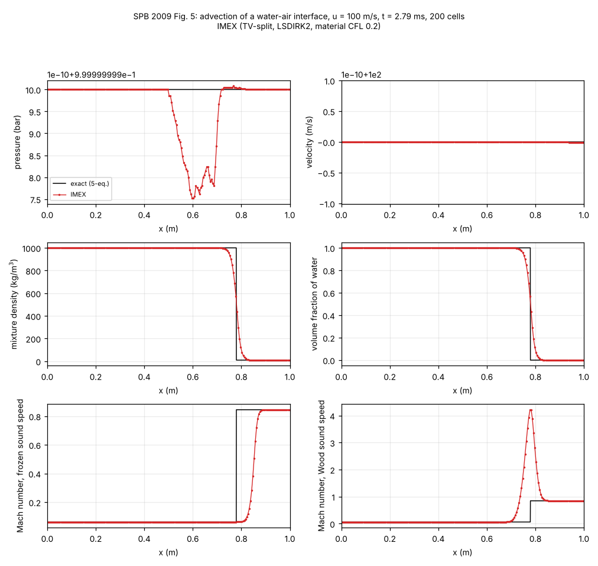

- $p$、$u$ 在全场保持常数：显式 $\max|p/p_0-1|=8\times10^{-10}$，IMEX $1.5\times10^{-9}$（Newton 容差）。这是 WB（创新点 1）。
- 混合区里 Wood 声速的马赫数有尖峰（约 4.2），冻结声速的马赫数单调，与论文图 5 相同。这是 Wood 声速在混合区非单调的结果，不是误差。

### 图 8：水–气激波管，1 GPa | 0.1 MPa（1000 格，240 μs）

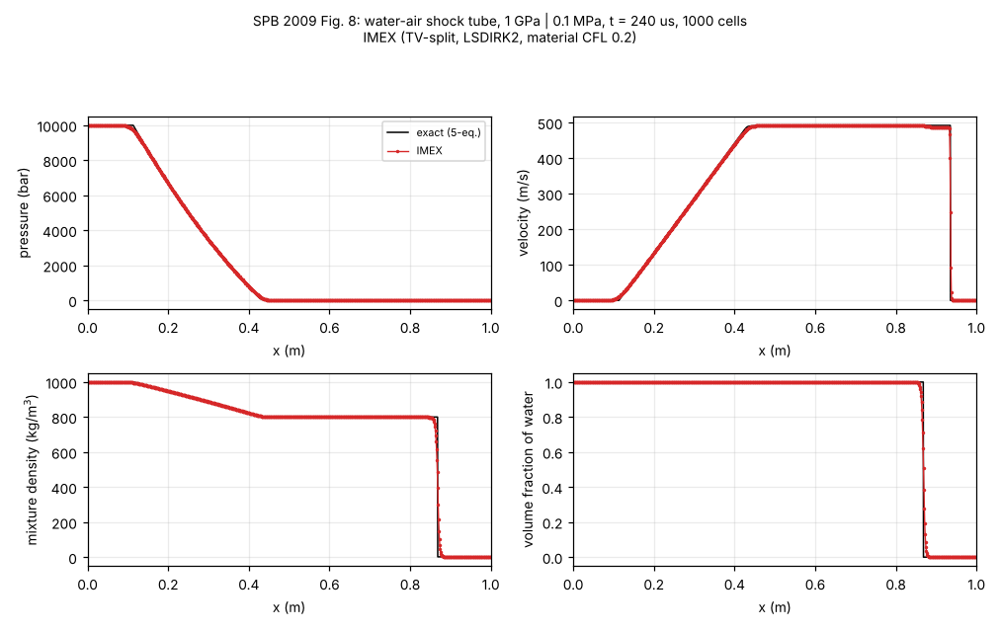

| | $L_1(u)$ | $\max u/u^*$ | 激波位置（精确 0.9345） |
|---|---|---|---|
| 显式 | 2.91 | 1.002 | 0.9385 |
| IMEX | 7.28 | 1.051 | 0.9445 |

- 显式与精确解（$p^*=4.80\times10^5$ Pa，$u^*=492.1$ m/s）吻合，与论文图 8 相同。
- IMEX 的稀疏波、接触间断正确；但气体中激波后的速度过冲 5%，激波超前约 10 格。这个问题未解决，见 C 页“仍未解决”第 2 条：偏差随网格一阶收敛，$N=4000$ 时为 1.005。

### 图 10：水–气激波管，1 TPa | 0.1 MPa，空气 10 kg/m³（1000 格，8.3 μs）

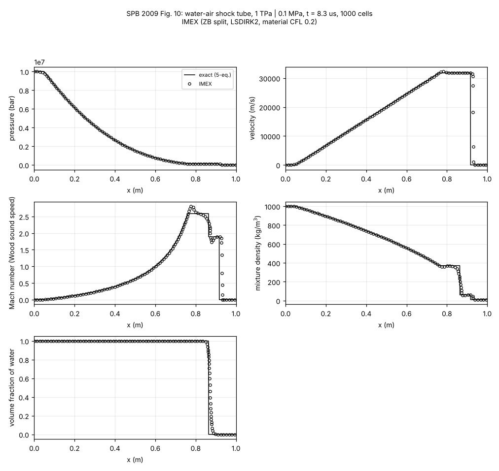

- 显式：$L_1(u)=17$，$\max u/u^*=1.010$，与论文图 10 相同（$u^*=31800$ m/s，马赫数约 2.6）。
- IMEX：$L_1(u)=128$；接触间断附近马赫数过冲（约 2.95 对 2.6）、密度下冲。这是未解决的 4.3.2 尾部误差。

### 图 12：空化管，$\alpha_{\rm air}=10^{-2}$，$u=\mp100$ m/s（1000 格，1.85 ms）

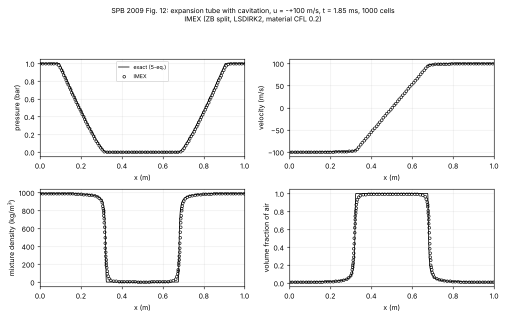

- 5 方程精确解在中心是真空：逃逸速度 5.79 m/s < 100 m/s，真空区 $x\in[0.326,0.674]$，$p=0$，$\alpha_{\rm air}=1$。
- 中心压力：显式 2211 Pa，IMEX 2254 Pa（论文图上也接近 0，约 0.02 bar 量级看不出）。来源是初始速度间断处的起步加热，两种格式相同。
- 扇区 $L_1(u)$：显式 0.090，IMEX 0.049。显式在空腔边缘有一个小的压力鼓包（约 0.12 bar），IMEX 没有。

### 图 19：环氧–尖晶石，$10^{10}$ Pa | $10^5$ Pa（500 格，80 μs）

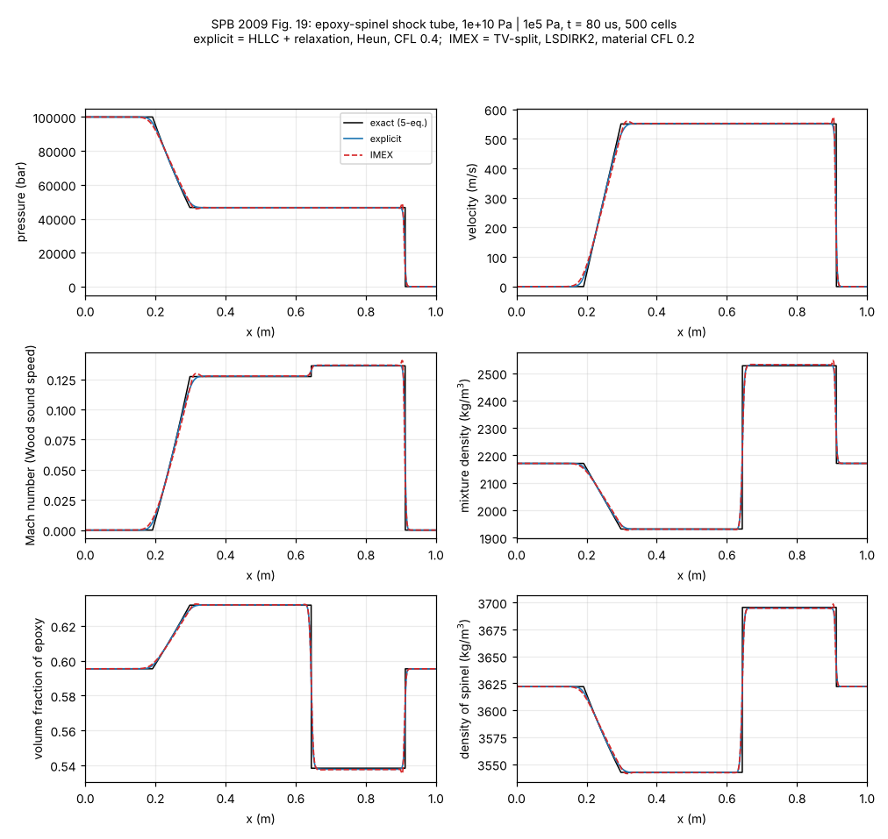

- 两者都收敛到 5 方程精确解：激波后混合密度显式 2530、IMEX 2547，精确 2527.5。
- 马赫数平台 0.127 / 0.136（按 Wood 声速）与论文图 19 相同；按冻结声速则只有 0.076 / 0.079。所以论文的“Mach number”用的是 Wood 声速。
- IMEX 在激波处有一个小尖峰（$\max p/p^*=1.051$）。

### 图 20：环氧–尖晶石，$2\times10^{11}$ Pa（500 格，34 μs）

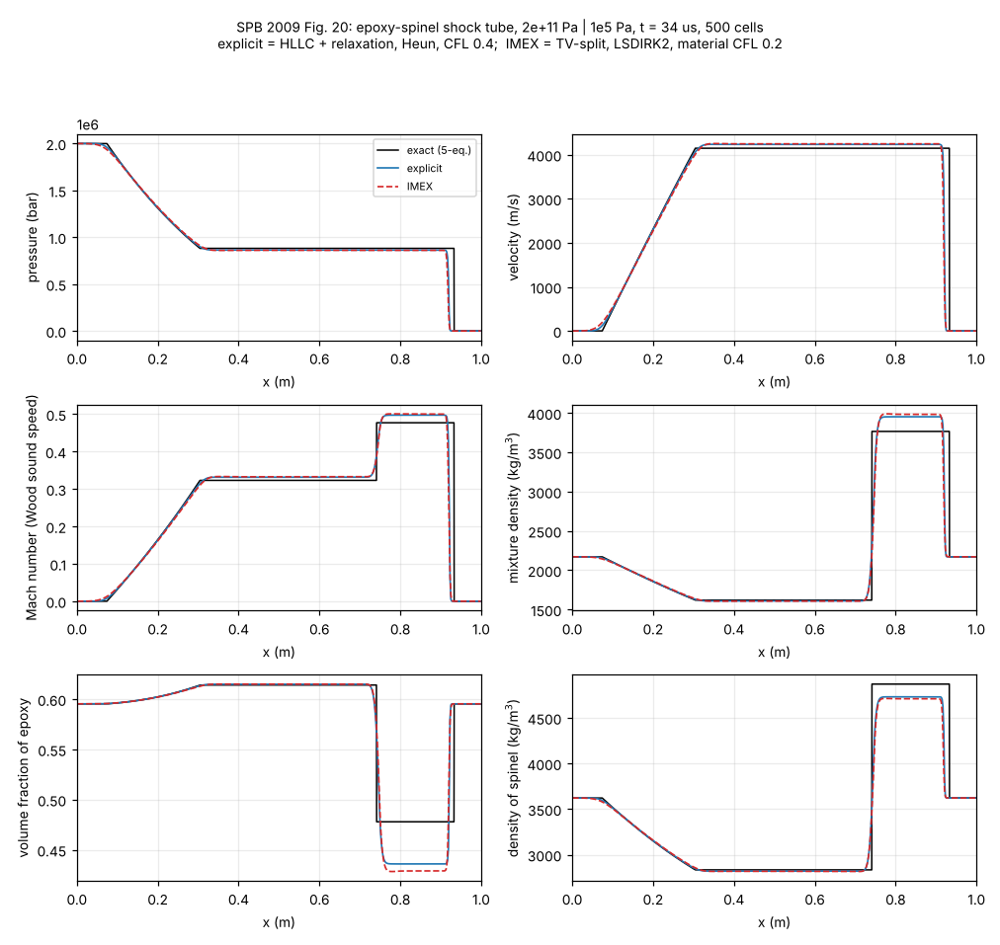

- 两者都不收敛到 5 方程精确解：激波后混合密度显式 3953、IMEX 3990，精确 3767；尖晶石密度、体积分数、马赫数同样偏离。
- 这正是论文图 20 要说明的现象（SPB §5.2）：数值激波层里两相内能的分配不对，激波后状态不在混合物 Hugoniot 上。SPB §5.3 的人工热交换不属于五个创新点，没有实现。

---

## 2. Pelanti & Shyue 2014（四个松弛档位：$p$、$p$–$pT$、$p$–$pT$–$pTg$、$p$–$pTg$）

### 图 1：水空化管，$u=\mp2$ m/s（5000 格，3.2 ms）

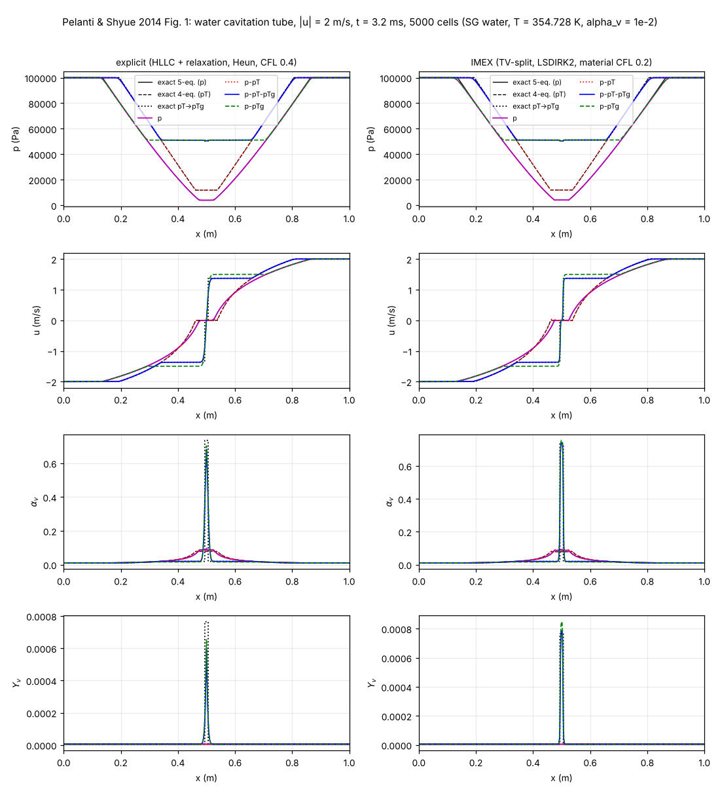

中心值（$x=0.5$）：

| 档位 | 量 | 显式 | IMEX | 精确 | P-S 图 1（读图） |
|---|---|---|---|---|---|
| $p$ | $p$（Pa） | 4021 | 4012 | 4010（5 方程） | $\approx5\times10^3$ |
| $p$–$pT$ | $p$（Pa） | 11854 | 11847 | 11847（4 方程） | $\approx1.2\times10^4$ |
| $p$–$pT$–$pTg$ | $p$（Pa）；$\alpha_v$；$Y_v$ | 50487；0.682；$5.9\times10^{-4}$ | 50289；0.740；$7.84\times10^{-4}$ | 50306；0.735；$7.65\times10^{-4}$（$pT\to pTg$ 扇） | $\approx5\times10^4$；$\approx0.33$；$\approx1.3\times10^{-4}$ |
| $p$–$pTg$ | $p$（Pa）；$\alpha_v$；$Y_v$ | 50424；0.703；$6.5\times10^{-4}$ | 50222；0.755；$8.5\times10^{-4}$ | — | 与上一档相近 |

- $p$、$p$–$pT$ 两档：两种格式都与 5 方程、4 方程精确解一致，中心压力误差不超过 0.3%。
- $p$–$pT$–$pTg$：中心是宽约 1 cm 的蒸发尖峰，蒸发扇的特征速度只有几 m/s。
  - IMEX 在 5000 格上与精确扇一致（$\alpha_v$ 0.740 对 0.735）；显式为 0.68。
  - P-S 图 1（同为 5000 格）只有约 0.33：论文的数值解把尖峰抹低了。原因是低马赫耗散：HLLC 对这个慢结构的耗散 $\sim c\Delta x$，IMEX 只有 $\sim|u|\Delta x$（C 页 V7 §7.1）。
- $p$–$pTg$ 只在亚稳态激活热、化学松弛。它的波形与论文相同：饱和平台更宽（$x\approx0.31$–0.69），平台上 $|u|\approx1.5$ m/s。

### 图 2：水空化管，$u=\mp500$ m/s（5000 格，0.58 ms）

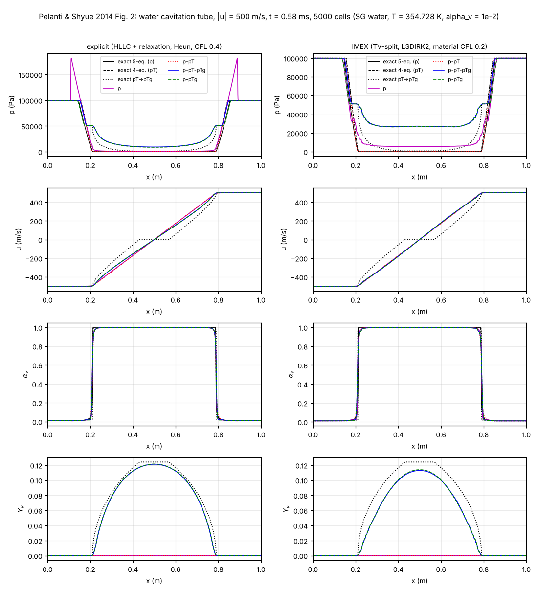

中心值（$x=0.5$）：

| 档位 | 显式 | IMEX | 精确 | P-S 图 2（读图） |
|---|---|---|---|---|
| $p$：中心 $p$ | 542 Pa | 5390 Pa | 0（真空） | $\approx0$ |
| $p$–$pT$：中心 $p$ | 0.4 Pa | 1.9 Pa | 0（真空） | $\approx0$ |
| $p$–$pT$–$pTg$：中心 $p$；$Y_v$ | $9.0\times10^3$ Pa；0.121 | $2.7\times10^4$ Pa；0.113 | 664 Pa；0.124 | $\approx1.1\times10^4$ Pa；$\approx0.145$ |
| $p$–$pTg$：中心 $p$；$Y_v$ | $8.5\times10^3$ Pa；0.122 | $2.7\times10^4$ Pa；0.114 | — | 同上 |

- **波形与论文图 2 相同。**
  - 不带传质的两档中心是真空：5 方程与 4 方程的扇在 $u=0$ 之前就降到 $p=0$。
  - 带传质的两档在 $x\approx0.2$ 处有一个饱和平台（约 $5.1\times10^4$ Pa，即蒸发前沿），中心是 U 形低压区。
- **中心状态都远离精确扇（664 Pa）。**
  - 所有数值解，包括论文的，都在初始速度间断处产生起步熵增，中心温度偏高（显式 316 K、IMEX 340 K，精确 274 K），饱和压力随之偏高。
  - 显式的中心压力（$9.0\times10^3$）接近论文（约 $1.1\times10^4$）；IMEX 的起步加热更大（$2.7\times10^4$）。
  - 这是 C 页“仍未解决”第 4 条。
- **显式 $p$ 松弛在 $x\approx0.11$ 与 0.89 处有一个压力尖峰（$1.8\times10^5$ Pa），论文没有。**
  - 来源：第一步中心面的 HLLC 星区压力为 $-8\times10^8$ Pa，即冻结的 6 方程里刚硬的液体承受拉应力。
  - 守恒的动量、能量通量因此把动能变成混合物内能；力学松弛按守恒总能给出约 $3\times10^7$ Pa、汽相 $6\times10^6$ K 的起步态，再向两侧传播成这个尖峰。
  - 它与空间阶数、CFL 无关，去掉 SPB 的总能重初始化也一样。
  - $pT$ 松弛（热量交给液体）和 IMEX 都没有这个尖峰。IMEX 的动量直接用闭合给出的松弛压力（创新点 2），不经过冻结的拉应力。
  - 论文图 2 没有这个尖峰；P-S 用的是他们自己的“混合能量一致”六方程格式，不是 SPB 的显式格式，我们没有实现它。详见 C 页 V8 §8.7。

### 图 3：十二烷液–汽激波管（SG，2000 格，473 μs）

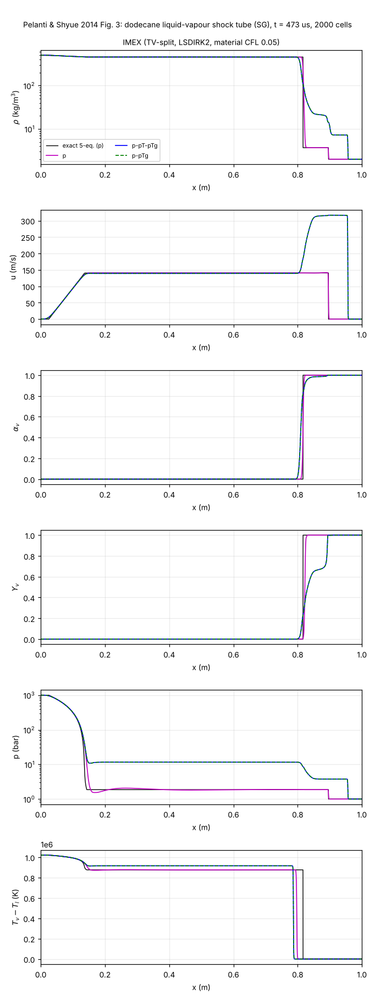

| | 显式 | IMEX | 精确 / 论文 |
|---|---|---|---|
| $p$ 松弛：平台 $p$（bar） | 1.85 | 1.85 | 5 方程精确 1.87 |
| $p$ 松弛：$L_1(p)$（$10^5$ Pa）；平台 $L_1(p)/p^*$ | 0.99；0.026 | 2.21；0.017 | — |
| $p$–$pT$–$pTg$：平台 $p$（bar）；$\max u$（m/s） | 11.62；318 | 11.61；319 | 论文图 3：约 11、约 310 |
| $T_v-T_l$：左平台；中间（$pTg$ / $p$）（K） | $1.02\times10^6$；$9.2\times10^5$ / $8.8\times10^5$ | 同左 | P-S 更正：同左 |

- $p$–$pT$–$pTg$ 与 $p$–$pTg$ 在这个算例里结果相同，论文也说两者“看不出差别”。
- 两个松弛档位下，液体平台都恰好在液体温度对应的饱和压力上：$T_l=605.65$ K，$p_{\rm sat}=11.616$ bar，数值平台 11.611 bar。
- $T_v-T_l$ 这一栏与 P-S 的更正（JCP 288 (2015) 196，原文图 3 的这一栏是后处理错误）一致，与原文图不一致。

---

## 3. Pelanti 2022（有限速率与瞬时松弛）

### 图 4：水空化管（NASG，$u=\mp2$ m/s，5000 格，3 ms），五个松弛档位

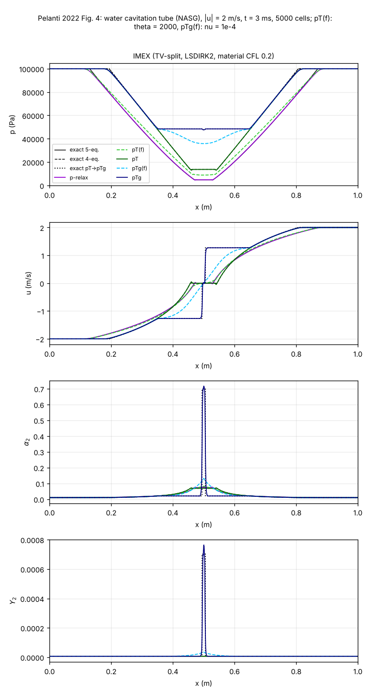

中心压力，单位 Pa：

| 档位 | 论文（读图） | 显式 | IMEX | 精确 |
|---|---|---|---|---|
| $p$ | $\approx5\times10^3$ | 4803 | 4795 | 4795（5 方程） |
| $pT(f)$，$\vartheta=2000$ | — | 8886 | 8849 | — |
| $pT$ | $\approx1.3\times10^4$ | 13688 | 13683 | 13683（4 方程） |
| $pTg(f)$，$\nu=10^{-4}$ | $\approx3.6\times10^4$ | 35874 | 35855 | — |
| $pTg$ | $\approx4.8\times10^4$ | 47894 | 47727 | 47724（$pT\to pTg$ 扇） |

- $pTg$ 中心尖峰的 $\alpha_2$ / $Y_2$：显式 0.638 / $5.4\times10^{-4}$，IMEX 0.706 / $7.27\times10^{-4}$，精确 0.698 / $7.02\times10^{-4}$。
- IMEX 在 5000 格上与三个精确解都吻合。显式把很窄的蒸发尖峰抹低了，与 P-S ±2 m/s 的情形相同（C 页 V7 §7.1：HLLC 对慢结构的耗散 $\sim c\Delta x$）。

### 图 5：温度与化学势（有温度平衡的三个档位）

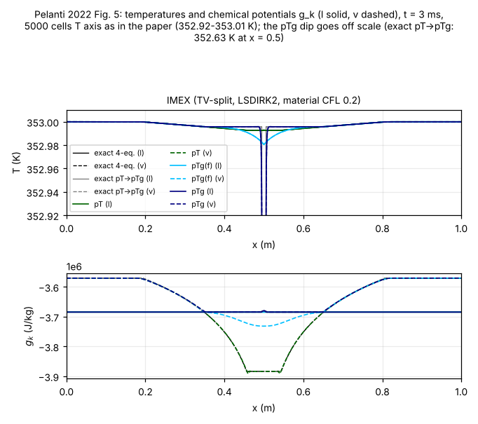

- 三个档位的液、汽温度都重合，即瞬时热平衡。
- 中心温度：$pT$ 352.993 K（4 方程精确 352.9927 K），$pTg(f)$ 352.98 K，与论文图 5 相同。
- $pTg$ 的精确扇在中心是 352.632 K，IMEX 352.620 K，显式 352.72 K；论文图上只降到约 352.94 K。饱和温度在这里约 0.5 K/kPa，352.94 K 对应中心压力约 48.3 kPa（精确 47.7 kPa）。所以论文的 5000 格解同样抹低了这个尖峰，与上一条一致。
- 化学势：$pT$ 的 $g_v$ 在中心降到 $-3.88\times10^6$ J/kg，$pTg(f)$ 降到 $-3.73\times10^6$，$pTg$ 在激活区两相相等，与论文图 5 相同。

### 图 6：十二烷液–汽激波管（NASG，2000 格，473 μs）

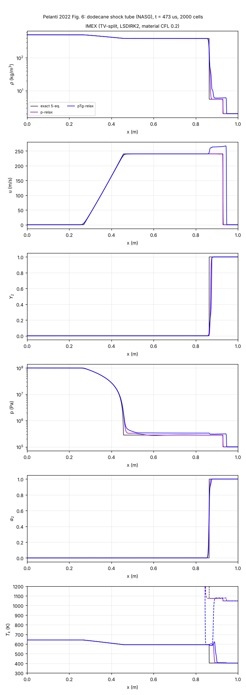

- $p$ 松弛与 5 方程精确解吻合：平台 $p$ 显式 $2.85\times10^5$、IMEX $2.82\times10^5$、精确 $2.82\times10^5$ Pa（论文读图 $2.75\times10^5$）；$u=240$ m/s；液体温度 593 K。
- $pTg$：显式与 IMEX 一致（液体平台 $3.34\times10^5$ / $3.37\times10^5$ Pa，$\max u$ 264 / 269 m/s），但论文是 $4.7\times10^5$ Pa、约 295 m/s。

**$pTg$ 差别的原因：论文表 4 的参数只印到四位，饱和曲线对它们极其敏感。**

- 与 P-S 的 SG 十二烷一样，液体平台就是液体温度对应的饱和压力。用表 4 原样的参数，$p_{\rm sat}(593\ {\rm K})=3.33\times10^5$ Pa，我们的平台正在这里。
- 液体 $\gamma$ 取 1.2055–1.2065（印出来都是 1.206）时，$p_{\rm sat}(593\ {\rm K})$ 从 $2.3\times10^5$ 变到 $4.8\times10^5$ Pa；汽相 $c_v$ 改 0.1%、汽相 $\eta'$ 改 0.4% 的效果相同。
- 用 $\gamma_l=1.2065$ 重算（只在草稿目录，代码仍用表 4 原样），IMEX 给出：
  - 液体平台 $4.78\times10^5$ Pa；
  - $\max u=303$ m/s；
  - 接触–激波间 $3.56\times10^5$ Pa；
  - $p$ 松弛不变。

  与论文（$4.7\times10^5$、约 295、$3.45\times10^5$）一致。
- 表 4 原样的饱和曲线比实际十二烷低约一半：593 K 时 3.3 bar，实际约 7.5 bar。Pelanti 在 8.2.3 节与实验比较时也改用了 P-S 的 SG 参数，理由是它与实验饱和曲线吻合。
