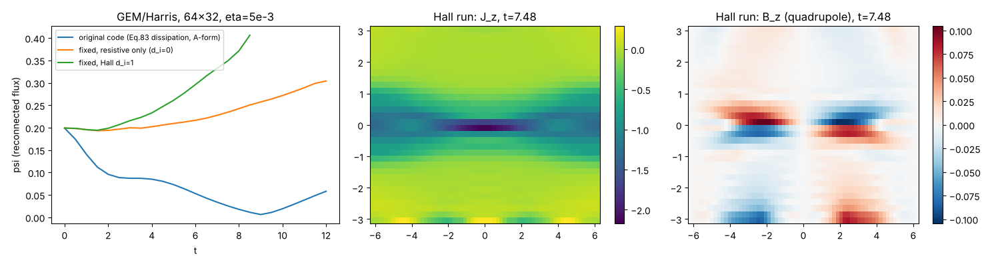

# Hall-MHD 的 IMEX 格式：推导、修改记录与验证

代码：`HallMHD.cpp`（单文件，Eigen + Boost）。时间推进、三分裂、磁/压力两个隐式子系统、压力保正 Newton 都沿用 v1 论文
（Chen, Dematté, Boscheri, Millmore, arXiv:2608.15837，下称 **[v1]**）；粘性、电阻、热传导这些耗散项按
Dematté et al., JCP 514 (2024) 113229 第 3.4 节处理（下称 **[RD]**）；Hall 项、超电阻和 Harris/GEM 设置
取自显式 Hall-MHD 报告（下称 **[report]**）。

```
g++ -O2 -std=c++17 -I/usr/include/eigen3 [-DNXCELLS=64 -DNYCELLS=32] HallMHD.cpp -o hall
./hall                                   # 默认：testHarrisHall（报告 Table 4.6 Test 12）
./hall test=Whistler dt=0.0025           # 验证算例，见第 6 节
./hall test=HarrisHall mu=1e-3 eta=5e-3 div=stag bvisc=mat out=./Plot/
```
命令行参数（都可省略）：`test= eta= mu= kappa= di= hyper= hall=0|1 tend= dt=(固定步长) cfl= bvisc=mag|mat div=A|stag|unstag out=`。

---

## 1. 方程

无量纲（$\mu_0=1$，$\mathbf J=\nabla\times\mathbf B$），常数 $d_i$：

$$
\begin{aligned}
&\partial_t\rho+\nabla\cdot(\rho\mathbf u)=0,\\
&\partial_t(\rho\mathbf u)+\nabla\cdot\Big(\rho\mathbf u\otimes\mathbf u+(p+\tfrac12|\mathbf B|^2)\mathbf I-\mathbf B\otimes\mathbf B\Big)=\nabla\cdot\boldsymbol\tau,\\
&\partial_t E+\nabla\cdot\Big((E+p+\tfrac12|\mathbf B|^2)\mathbf u-(\mathbf u\cdot\mathbf B)\mathbf B\Big)
 =\nabla\cdot(\boldsymbol\tau\mathbf u)+\nabla\cdot(\kappa\nabla T)-\nabla\cdot(\mathbf E_n\times\mathbf B),\\
&\partial_t\mathbf B+\nabla\times\mathbf E=0,\qquad \mathbf E=-\mathbf u\times\mathbf B+\mathbf E_n,
\end{aligned}
$$

非理想电场（[report] Eq. 2.24, 7.3）

$$
\mathbf E_n=\eta\mathbf J+\frac{d_i}{\rho}\,\mathbf J\times\mathbf B-\eta_H\nabla^2\mathbf J ,
$$

$\boldsymbol\tau=\mu(\nabla\mathbf u+\nabla\mathbf u^{T}-\tfrac23(\nabla\cdot\mathbf u)\mathbf I)$（[RD] Eq. 53），$T=p/((\gamma-1)c_v\rho)$（[RD] Eq. 64）。

**与显式结果的 $B_z$ 四极符号对比（$t=5$，128×64）。** IMEX 结果 `figures/quadrupole_t5_open.png` 与显式结果整体反号；
用 `di=-1`（即 $\mathbf E_H=-\mathbf J\times\mathbf B/ne$，报告 Eq. 3.31 的写法）重算得到 `figures/quadrupole_t5_open_di_minus1.png`，
符号分布与显式结果一致，说明显式代码实际用的是负号。早期线性估计 $\partial_tB_z=-\frac{d_i}{\rho}\mathbf B\cdot\nabla J_z$：
右上象限 $B_y>0$、$\partial_yJ_z>0$，故 $B_z<0$，与 IMEX（正号）一致；哨声波验证也只有正号才与解析色散关系吻合。

**Hall 电场符号。** [report] Eq. (3.31) 写的是 $\mathbf E_H=-\mathbf J\times\mathbf B/ne$，但与它自己的 (2.24) 和 (3.32)
$\mathbf B^{n+1}=\mathbf B^*-\Delta t\nabla_h\times\mathbf E_H$ 矛盾；正确的是 $+\mathbf J\times\mathbf B/ne$，代码一直用的是正号。

**能量方程里的 Poynting 项。** 由感应方程，$\partial_t\tfrac12|\mathbf B|^2=-\nabla\cdot(\mathbf E\times\mathbf B)-\mathbf J\cdot\mathbf E$。
理想部分 $-\mathbf u\times\mathbf B$ 给出 $F^{\mathbf B}$ 中的 $|\mathbf B|^2\mathbf u-(\mathbf u\cdot\mathbf B)\mathbf B$；非理想部分给出
总能量通量 $\mathbf E_n\times\mathbf B$（[RD] Eq. 63 中的 $\Pi$ 项）。内能因此得到 $\mathbf J\cdot\mathbf E_n=\eta J^2+\eta_H|\nabla\mathbf J|^2-\nabla\cdot(\dots)$，
Hall 部分 $\mathbf J\cdot(\mathbf J\times\mathbf B)=0$ 不做功。

## 2. 分裂与一个隐式级的步骤

[v1] 的三分裂 $\mathbf F=\mathbf F^c+\mathbf F^p+\mathbf F^{\mathbf B}$ 保持不变；新增的通量按“谁的刚性”归属：

| 通量 | 归属 | 处理 |
|---|---|---|
| 感应方程里的 $\mathbf E_n$（$\eta$、Hall、$\eta_H$） | 磁子系统 | 隐式（Hall 线性化见 3.1） |
| 动量里的 $\boldsymbol\tau$，能量里的 $\boldsymbol\tau\mathbf u$ | 磁与压力两步之间的粘性子步 | 隐式（[RD] Eq. 62） |
| 能量里的 $\mathbf E_n\times\mathbf B^{n+1}$ | 进 $E^{**}$ | 用已知的 $\mathbf B^{n+1}$，通量形式 |
| 能量里的 $\kappa\nabla T$ | 压力子系统 | 隐式，进耦合矩阵 $\underline{\underline T}$ |

LSDIRK2 的每一级（步长 $h=a_{ii}\Delta t$）：

1. 显式对流（[v1] Eq. 81）：$\rho^{n+1},(\rho\mathbf u)^*,E^*$。
2. 隐式磁子系统 + 非理想项（3.1）：预测场 $\tilde{\mathbf B}^{n+1}$。
3. 磁通量更新动量、能量（[v1] Eq. 84）：$(\rho\mathbf u)^{**},E^{**}$。
4. **新增** 非理想 Poynting 通量（3.2）：$E^{**}\leftarrow E^{**}-h\nabla_h\cdot(\mathbf E_n\times\tilde{\mathbf B}^{n+1})$。
5. **新增** 隐式粘性子步（3.3）：$(\rho\mathbf u)^{**}\leftarrow(\rho\mathbf u)^{**}+h\nabla_h\cdot\boldsymbol\tau(\tilde{\mathbf u})$，$E^{**}\leftarrow E^{**}+h\nabla_h\cdot(\boldsymbol\tau\tilde{\mathbf u})$。
6. 两次压力求解（[v1] Eq. 86–89），压力方程带热传导（3.4），保正 Newton 不变。
7. $E^{n+1}=\underline V_{\rm mod}(p^{n+1})+k^{n+1}+m^{n+1}$（[v1] Eq. 91）。
8. 散度约束：交错 CT 或非交错 CT，角点电场含非理想部分（第 4 节）。

## 3. 推导

### 3.1 磁子系统（含 Hall、电阻、超电阻）

[v1] Eq. (27)：动量在磁步里取 $\mathbf u_m=\big[(\rho\mathbf u)^*-h\nabla p^e-h\nabla\cdot\mathbf M(\mathbf B^e,\mathbf B^{n+1})\big]/\rho^{n+1}$，
$\mathbf M(\mathbf B^e,\mathbf B)=\tfrac12(\mathbf B^e\cdot\mathbf B)\mathbf I-\mathbf B^e\otimes\mathbf B$（$|\mathbf B|^2\approx\mathbf B^e\cdot\mathbf B^{n+1}$），代入
$\mathbf B^{n+1}=\mathbf B^*+h\nabla\times(\mathbf u_m\times\mathbf B^e)-h\nabla\times\mathbf E_n$。Hall 项关于 $\mathbf B$ 是二次的，和理想张力一样线性化：
电流取未知量，乘子 $\mathbf B$ 冻结在显式级 $\mathbf B^e$（= `Qe`）：

$$
\mathbf E_n^{\rm lin}=\eta\,\mathbf J(\tilde{\mathbf B})+\frac{d_i}{\max(\rho^{n+1},\rho_{\rm floor})}\,\mathbf J(\tilde{\mathbf B})\times\mathbf B^e-\eta_H\nabla_h^2\mathbf J(\tilde{\mathbf B}).
$$

于是（B 形式，`Magnetic_Subsystem_AX`）

$$
\tilde{\mathbf B}+h\,\nabla_h\times\!\Big(\frac{d_i}{\rho}(\nabla_h\times\tilde{\mathbf B})\times\mathbf B^e\Big)-h\eta\,\Delta_h\tilde{\mathbf B}+h\eta_H\Delta_h^2\tilde{\mathbf B}
-h^2\,\nabla_h\times\Big(\frac{\nabla_h\cdot\mathbf M(\mathbf B^e,\tilde{\mathbf B})}{\rho}\times\mathbf B^e\Big)-h\nabla_h\cdot(\kappa_B\nabla_h\tilde{\mathbf B})=\mathbf B^{*}_{\rm rhs},
$$

（$\nabla\cdot\mathbf B=0$ 时 $-\nabla\times(\eta\nabla\times\mathbf B)=\eta\Delta\mathbf B$，$\nabla\times(\eta_H\nabla^2\mathbf J)=-\eta_H\Delta^2\mathbf B$。）
A 形式（`Magnetic_Subsystem_potential_AX`，Weyl 规范 $\partial_t\mathbf A=-\mathbf E$）是同一个方程去掉一层旋度：

$$
\tilde{\mathbf A}+h\frac{d_i}{\rho}\mathbf J(\tilde{\mathbf A})\times\mathbf B^e-h\eta\Delta_h\tilde{\mathbf A}+h\eta_H\Delta_h^2\tilde{\mathbf A}+h\Big(\frac{\nabla_h\cdot\mathbf M}{\rho}\Big)\times\mathbf B^e-h\nabla_h\cdot(\kappa_B\nabla_h\tilde{\mathbf A})=\mathbf A_s+h\,\mathbf S\times\mathbf B^e .
$$

**为什么 Hall 必须隐式。** 平行于 $\mathbf B_0$ 的线性 Hall-MHD 色散关系（3.5 节验证算例的解析解）

$$
\omega=k v_A\Big(\tfrac{kd_i}{2}+\sqrt{1+(\tfrac{kd_i}{2})^2}\Big)\;\xrightarrow{kd_i\gg1}\;\omega_w=\frac{d_i|\mathbf B|}{\rho}k^2 .
$$

网格尺度 $\omega_w\Delta t\sim d_i|\mathbf B|\Delta t/(\rho\Delta x^2)$。纯色散项的特征值在虚轴上：显式 Euler $|1+i\omega h|>1$ 无条件不稳定，
RK4 需要 $\omega h\le2.83$（[report] 7.1.2，因此需要 $\Delta t\propto\Delta x^2$ 和子循环）；隐式 Euler $|1/(1+i\omega h)|\le1$，
LSDIRK2 是 L-稳定的，所以时间步只受材料速度 CFL 限制。`hall_omega_cap`（默认 8）只是精度上限，不是稳定性要求。

### 3.2 能量：非理想 Poynting 通量，以及原代码 Joule 热被计算了两次

[v1] 的能量是“定义式”：压力方程的右端是 $E^{**}-\tfrac12|\tilde{\mathbf B}^{n+1}|^2-k$（代码里 `p_star = u_con(i,j,4) - 0.5*B2`），
即隐式磁步对 $m=\tfrac12|\mathbf B|^2$ 的**所有**改变都记到内能上。把磁步拆成理想+非理想两部分：

$$
m^{n+1}-m^{n}=\underbrace{(\dots)_{\rm ideal}}_{\text{被 }F^{\mathbf B}\text{ 通量平衡}}\;-\;h\nabla\cdot(\mathbf E_n\times\mathbf B)\;-\;h\,\mathbf J\cdot\mathbf E_n+O(h^2).
$$

若 $E^{**}$ 里没有非理想通量（原代码），内能改变量是 $-(\Delta m)_n=h\,\mathbf J\cdot\mathbf E_n+h\nabla\cdot(\mathbf E_n\times\mathbf B)$：

* 电阻部分 $h\eta J^2$ **已经**在里面了，原代码又在压力右端加了一次 `RHS += h*Joule_heating` → **重复计算**；
* $h\nabla\cdot(\mathbf E_n\times\mathbf B)$ 被就地当成加热/冷却。对 Hall 项这是哨声波的能量输运，局部符号不定，会把 $p$ 推向负值。

修正（`NonIdeal_Energy_Update`，[RD] Eq. 63）：

$$
E^{**}\leftarrow E^{**}-\frac{h}{\Delta x}\big(\mathcal S^x_{i+\frac12}-\mathcal S^x_{i-\frac12}\big)-\frac{h}{\Delta y}\big(\mathcal S^y_{j+\frac12}-\mathcal S^y_{j-\frac12}\big),\qquad
\mathcal S^x=(\mathbf E_n\times\tilde{\mathbf B})_x=E_yB_z-E_zB_y,\;\mathcal S^y=E_zB_x-E_xB_z,
$$

面值取相邻两单元的算术平均，$\mathbf E_n$ 用 $\tilde{\mathbf B}^{n+1}$ 和中心差分电流（[report] Eq. 3.25–3.27）。并删除显式 Joule 源。
这样内能得到的就是 $h\,\mathbf J\cdot\mathbf E_n$（离散意义下到截断误差），总能量仍然是通量形式、全局守恒（[v1] Theorem 2 的证明不受影响）。

### 3.3 粘性子步（[RD] Eq. 62 适配到顺序结构）

[RD] 在 Picard 迭代里先解“临时动量”：动量方程中粘性取隐式、压力取当前 Picard 值。顺序的 IMEX 结构里对应为：

$$
\rho^{n+1}\tilde{\mathbf u}-h\nabla_h\cdot\boldsymbol\tau(\tilde{\mathbf u})=(\rho\mathbf u)^{**}-h\nabla_h p^{e}\tag{V1}
$$

（磁力已经在 $(\rho\mathbf u)^{**}$ 里，压力梯度取显式级，与 [v1] Eq. 27 的磁步做法一致），然后以通量形式

$$
(\rho\mathbf u)^{**}\leftarrow(\rho\mathbf u)^{**}+h\nabla_h\cdot\boldsymbol\tau(\tilde{\mathbf u}),\qquad
E^{**}\leftarrow E^{**}+h\nabla_h\cdot\big(\boldsymbol\tau(\tilde{\mathbf u})\,\bar{\tilde{\mathbf u}}\big).\tag{V2}
$$

之后两次压力求解原封不动，于是 $(\rho\mathbf u)^{n+1}=(\rho\mathbf u)^{**}+h\nabla\cdot\boldsymbol\tau(\tilde{\mathbf u})-h\nabla\tilde p^{n+1}$；
$\tilde{\mathbf u}$ 与 $\mathbf u^{n+1}$ 只差 $O(h\,\delta p)$。动能变化进入压力方程右端的 $k$，所以内能得到粘性耗散 $\boldsymbol\tau:\nabla\mathbf u$。

面梯度：法向导数用紧致两点差分，切向导数用 [RD] Eq. (57)–(58) 的梯形平均，例如 $x$ 面 $(i+\frac12,j)$：

$$
\partial_xu=\frac{u_{i+1,j}-u_{i,j}}{\Delta x},\qquad
\partial_yu=\frac{u_{i,j+1}+u_{i+1,j+1}-u_{i,j-1}-u_{i+1,j-1}}{4\Delta y}.
$$

（如果法向导数也用 (58) 的角点平均，$(-1)^{i+j}$ 模态的面梯度为零，粘性对它无阻尼。）(V1) 是 $3N$ 维线性系统，用已有 GMRES + Jacobi 预条件
（`Viscous_Subsystem_AX`、`Viscous_Update`）。

### 3.4 热传导

$T=p/(R\rho^{n+1})$，$R=(\gamma-1)c_v$，对 $p$ 是线性的，直接加到压力方程的耦合项（[RD] Eq. 63–64）：

$$
\underline V_{\rm mod}(p)-h^2\nabla_h\cdot(h^n\nabla_hp)-h\nabla_h\cdot(\tilde\kappa^n\nabla_hp)-h\kappa\,\Delta_h\!\Big(\frac{p}{R\rho^{n+1}}\Big)=b .
$$

只改 $\underline{\underline T}$、不改对角项 $\underline V$，所以嵌套 Newton 与保正修正（[v1] 3.4）不受影响。只对理想气体（RK 状态方程下 $T(\rho,p)$ 非线性，未实现）。

### 3.5 磁子系统的数值耗散 $\kappa_B$

[v1] Eq. (83) 在磁子系统里加 $-h\nabla\cdot(\kappa_B\nabla\tilde{\mathbf B})$，$\kappa_B=|\lambda^{\mathbf B}|\Delta x\approx c_A\Delta x$。这是 $O(c_A\Delta x)$ 的**数值电阻**：
GEM 片外 $\rho=0.2,|\mathbf B|=1$，$c_A\Delta x\approx2.2\times0.098\approx0.2$，是物理 $\eta=5\times10^{-3}$ 的 40 倍，
Lundquist 数从 ~2500 掉到 ~10。原代码的 Harris 算例因此根本不重联：片被直接扩散掉（见第 6 节）。

新增 `bvisc=mat`（`BviscMaterialShock`）：

$$
\kappa_{B,i+\frac12}=\tfrac12\max(|u_x|_i,|u_x|_{i+1})\,\Delta x+\chi_{i+\frac12}\,\lambda^{\mathbf B}_{i+\frac12}\Delta x .
$$

第一项恰好是材料速度 Rusanov 耗散：磁步中显式、中心差分的输运项（A 形式的 $-\mathbf u\cdot\nabla\mathbf A$，B 形式的 $\nabla\times(\mathbf u^*\times\mathbf B^e)$）因此变成迎风；
第二项只在激波指示子 $\chi$（[v1] Eq. 43）激活处恢复 Eq. (83)。光滑区数值电阻是 $O(|\mathbf u|\Delta x)$，符合 [v1] “耗散只与流速成比例”的思路。
`bvisc=mag` 保持 [v1] 原样（理想 MHD 激波算例默认仍用它，结果逐位不变）。

**`PotentialA`（隐式求解矢势）与 `bvisc=mat` 不兼容。** 这条路径里 $\mathbf B=\nabla_{2\Delta}\times\mathbf A$、$\mathbf J=\nabla_{2\Delta}\times\mathbf B$，
网格分裂成 4 个互不耦合的子格，只靠 Eq. (83) 的紧致 Laplacian 把它们粘在一起。去掉它以后（哪怕 Hall、$\eta$ 都关掉），
Harris 片的肩部在 $t\approx0.1$ 出现 $p$ 与 $|\mathbf B|^2$ 的奇偶交换，$p$ 掉到保正地板。B 形式求解 + CT（[v1] 3.6）没有这个问题，
所以 Hall 算例默认改为 `div=stag`。

## 4. 散度约束（CT）中的非理想电场

[RD] Eq. (61)：CT 的角点电场 = 理想 Gardiner–Stone 电场 + 由**预测场** $\tilde{\mathbf B}^{n+1}$ 计算的非理想电场。

* 电阻、超电阻：角点 $J_z$ 用 (61) 的四单元差分（与隐式步的 5 点 Laplacian 同为紧致型）。
* Hall：角点值取周围四个单元中心 $E_{H,z}(\tilde{\mathbf B})$ 的平均，单元电流用与隐式步相同的 $2\Delta x$ 中心差分。于是面更新恰好是预测步的 Hall 算子，例如
  $\partial_tB_y|_{i,j+\frac12}=\tfrac12\sum_{j,j+1}(E_{i+1}-E_{i-1})/(2\Delta x)$。

原代码在理想 CT 之后用“理想步之后的面场”再做一次显式 Faraday 步：Hall 在 CT 中退化成前向 Euler，
隐式磁步对哨声波的稳定作用被丢掉。改成预测场之后若仍用紧致角点电流，又会出现另一个问题：$(-1)^i$ 模态隐式步的 $2\Delta x$ 算子看不到，
CT 却会对它显式推进 → $\omega_w h>2$ 时发散（哨声算例 `div=stag dt=0.01` 得到 NaN）。用单元平均后 `dt=0.1`（$\omega_w h\approx40$）稳定。
非交错 CT（`div=unstag`）原来完全没有非理想项（$\mathbf B=\nabla\times\mathbf A$ 覆盖预测场后 $\eta$、Hall 全部丢失），现在 $A_z$ 更新加上 $-hE_{n,z}(\tilde{\mathbf B})$。

## 4b. $y$ 方向理想导体壁（`ybc=wall`，`testHarrisHall` 默认）

壁面在 $y_0,y_1$ 两个单元面上，ghost 单元取镜像，奇偶性为

| 偶（$\partial_y=0$） | 奇（壁面上为 0） |
|---|---|
| $\rho,\;p\,(E),\;v_x,\;v_z,\;B_x,\;B_z$ | $v_y$（不穿透），$B_y$（$\mathbf B\cdot\mathbf n=0$） |

即自由滑移的理想导体壁。导体壁的另一个条件是切向电场为零，$E_x=E_z=0$。对理想电场 $-\mathbf u\times\mathbf B$，它由上面的奇偶性自动满足；
对 Hall 电场则不然：$E_{H,z}=\frac{d_i}{\rho}(J_xB_y-J_yB_x)$ 中 $J_y=-\partial_xB_z$ 和 $B_x$ 都是偶的。所以电场单独施加奇偶性：
$E_x,E_z$ 奇、$E_y$ 偶。对应的实现位置：

* `bound_cond_u`、`bound_cond_array(·, ysign)`（压力步里的 $(\rho v)^*$ 取奇）、`M_P`/`M_B` 镜像映射；
* 隐式 B 求解：`XB(i,j,c)` 在壁外 ghost 处给 $B_y$ 反号，Hall 电场 lambda 在 ghost 处取镜像并对 $E_x,E_z$ 反号；
* 交错 CT：$B_y$ 壁面面是 CT 未知量（初值 0），ghost 面关于壁面奇对称；$B_x$ 偶对称；壁面角点 $E_z=0$，因此 $B_y|_{\rm wall}$ 永远为 0，没有磁通穿过壁面；
* `ExtrapolateGhostE`：非理想电场按上述奇偶镜像，使壁面 Poynting 通量 $(\mathbf E\times\mathbf B)_y=E_zB_x-E_xB_z=0$；
* `TVDReconstruction`：镜像会交换左右界面状态。ghost 单元在壁面上的状态必须是内部单元**在同一壁面上**状态的镜像，而原来的 `bound_cond_u` 给的是内部单元另一侧界面的镜像，
  两侧状态不对称，能量从壁面泄漏（64×32 每步约 1e-8）。修正后周期 $x$ + 导体壁 $y$ 的封闭区域中，质量和总能量都守恒到 12 位有效数字（Hall、电阻都打开）。

$A$ 在壁面的条件仍是线性外推，所以 `div=A` 和 `div=unstag` 与导体壁一起用时会打印警告；Hall 算例请用 `div=stag`。

## 5. 修改清单（相对导入的原始文件，见 git 历史）

| # | 问题 | 后果 | 修改 |
|---|---|---|---|
| 1 | 磁子系统数值耗散 $\kappa_B=c_A\Delta x$ 总是开着 | 数值电阻 ≈ 40η，Harris 片扩散、ψ 单调下降、内能以 ~8/时间单位虚假增长 | `bvisc_mode`，Hall 算例用材料速度 + 激波激活耗散 |
| 2 | 压力右端额外 `+h*eta*J^2` | Joule 热计算两次 | 删除 |
| 3 | $E^{**}$ 缺少 $\mathbf E_n\times\mathbf B$ 通量 | Hall/电阻的能量输运被当成局部加热 | `NonIdeal_Energy_Update` |
| 4 | 交错 CT 中非理想电场来自理想步后的面场、单独的显式 Faraday 步 | Hall 在 CT 中是显式的 | 由预测场计算并并入角点电场（第 4 节） |
| 5 | 非交错 CT 不含非理想电场 | `div=unstag` 时 η、Hall 被丢掉 | $A_z$ 更新加上 $E_{n,z}$ |
| 6 | 隐式 Hall 中 $1/\rho$ 无地板（`1e-12`），CT 中有（0.02） | 两处 Hall 算子不一致 | 统一用 `hall_rho_floor` |
| 7 | 初始 `divB` 循环从 ghost 第 0 格开始读 `i-1` | 越界读（`-fsanitize=address` 报错，64×64 时段错误） | 只循环内部单元 |
| 8 | `printVTKVariable` 从下标 0（ghost）开始输出 | VTK 场整体平移 3 格，最后 3 行/列从未输出 | 只输出内部单元 |
| 9 | 开边界上 ghost 单元的 $\mathbf J$ 由复制的 $\mathbf B$ 差分得到（ghost 行 $J_x=0$） | 边界面上的 Poynting 通量、CT 角点电场与内部不一致 | `ExtrapolateGhostE`；隐式 Hall 算子用同一闭合 |
| 10 | 没有粘性和热传导 | — | 按 [RD] 加入（3.3、3.4） |
| 11 | $y$ 方向没有导体壁（`y_Reflective` 把 $\mathbf B$ 三个分量全部取反） | GEM 的标准边界无法设置 | `y_ConductingWall`（4b 节） |

## 6. 验证

均为 LSDIRK2，`bvisc=mat`，一个周期/到 $t=1$，相对 $L^2$ 误差。

**电阻扩散**（`test=ResistiveDecay`，$B_x=\epsilon\sin2\pi y\,e^{-4\pi^2\eta t}$，$\eta=10^{-2}$，dt=0.005）

| 网格 | 误差 | 阶 |
|---|---|---|
| 32² | 5.16e-3 | – |
| 64² | 1.30e-3 | 1.99 |

总能量在输出的 7 位有效数字内不变；$\Delta E_{\rm int}=-\Delta E_{\rm mag}=1.37\times10^{-5}$（Joule 热只算一次）。staggered / unstaggered CT 给出 1.26e-3 / 1.39e-3（32²）。

**粘性扩散**（`test=ViscousDecay`，$u=w=\epsilon\sin2\pi y\,e^{-4\pi^2\mu t}$，$\mu=10^{-2}$）：32² 2.32e-3，64² 5.16e-4（阶 2.17），总能量守恒。

**平行哨声波**（`test=Whistler`，$kd_i=1$，$\omega=1.618$，精确的非线性圆偏振解，一个周期）

| 网格 | dt | `A` | `stag` | `unstag` |
|---|---|---|---|---|
| 32×4 | 0.01 | 5.79e-2 | 5.20e-2 | |
| 64×4 | 0.0025 | 1.45e-2 | 1.30e-2 | 1.49e-2 |
| 128×4 | 0.000625 | 3.63e-3 | 3.20e-3 | |
| 64×4 | 0.1（$\omega_wh\approx40$） | 2.18e-2 | 2.68e-2 | |

二阶收敛；时间步远大于显式哨声限制时依然稳定。原 Eq. (83) 耗散（`bvisc=mag`）在 64×4 上误差 24.9%（波被阻尼）。

**Harris / GEM**（`testHarrisHall`，64×32，$\eta=5\times10^{-3}$，$d_i=1$，`div=stag bvisc=mat ybc=wall`）



* 原代码（Eq. 83 耗散 + `PotentialA`）：$\psi$ 从 0.20 单调降到 ~0.01–0.06，片电流 $|J_z|_{\max}$ 1.87 → 0.27（$t=12$），即电流片被数值电阻扩散掉，没有重联；
  内能在 $t=0$ 就以 ~8/时间单位增长（物理 Joule 热应为 ~0.17）。
* 修正后、只有电阻、导体壁：$\psi$ 0.20 → 0.31（$t=12$），$|J_z|_{\max}\approx2.1$。
* 修正后、Hall、导体壁：$\psi$ 0.20 → 0.52（$t=12$），重联明显快于纯电阻；X 线电流集中，Hall 四极 $B_z$ 最大 0.16（$t\approx8$）。
  最小内能 ≥ 0.09，质量与总能量在整个计算中守恒到 12 位有效数字。
* 透射边界（`ybc=open`，报告原设置）：同一 Hall 算例在 $t\approx6$ 以后 $y=-\pi$ 第一、二行出现 $v_x\approx1$ 的边界射流和 $B_x$ 折角，
  $t\approx8.9$ 内能变负（图中虚线）。纯电阻算例无此现象，把 ghost 单元非理想电场改成零梯度外推（修改 #9）也没有消除。
  所以 Hall 算例默认改用导体壁。

`HallReconnectionDiagnostics` 的输出（`hall_reconnection.dat`、`hall_fields.bin`）写在当前目录，多个算例同时跑时请分目录。
