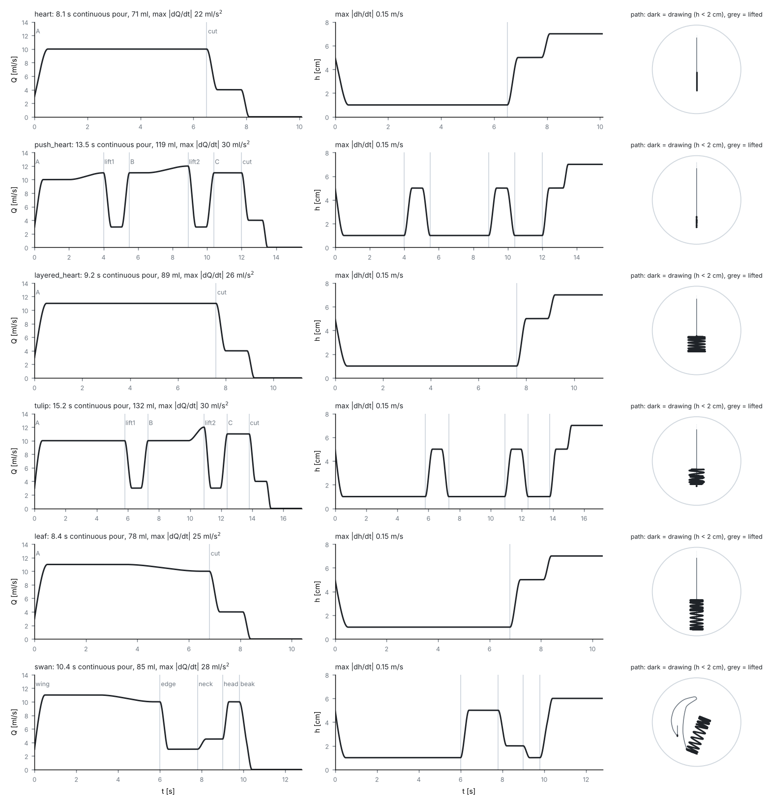

# 拉花模拟器 V4：二维守恒活动表层 + 0D 体相账本（阶段一）

输入是倒奶动作 ξ(t) = (缸嘴位置 x_p, 流量 Q, 落差 h_p)，输出是杯面图案。**一组方程、一组共享物理参数**
（`core/params.py::PhysParams()`），只换动作轨迹，产出大白心、推推乐、千层心、郁金香、树叶和天鹅六种图案，
并保留逐阶段形成过程。

动作是一只拉花缸能倒出来的连续动作（`actions/scripts.py`，`docs/MODEL.md` §5）：位置、流量、高度、摆动都是连续轨道，
速率有上限；从落嘴到收尾整杯一股流不断，两笔之间抬高收细流再压低，最后小流量拉高收尾。时序取自参考视频的字幕与帧。
`check_feasible` 检查任务书可行盒和手的限制（|dQ/dt| ≤ 40 ml/s²，|dh/dt| ≤ 0.25 m/s，加速度 ≤ 3 m/s²，流不中断），
六个图案都通过（`tests/test_gates.py`）。



- 模型与实现、与任务书的差异：[`docs/MODEL.md`](docs/MODEL.md)
- 验收方案（实现前写定）：[`docs/ACCEPTANCE.md`](docs/ACCEPTANCE.md)
- 结果报告（门禁、失败分析、敏感性、性能）：[`docs/REPORT.md`](docs/REPORT.md)
- 门禁总表 / 敏感性 / benchmark：[`docs/GATES_SUMMARY.md`](docs/GATES_SUMMARY.md)、[`docs/SENSITIVITY.md`](docs/SENSITIVITY.md)、[`docs/BENCHMARK.md`](docs/BENCHMARK.md)


## 目录

| 目录 | 内容 |
|---|---|
| `core/` | `solver_np.py` 求解器（`backend="numpy"` 为 fp64 参考，`"numba"` 为同算法循环核），`grid.py` 网格/核/粗细传递，`kernels_nb.py` numba 核（与阶段二 Warp 核一一对应），`params.py` 共享参数，`solver_warp.py` 阶段二接口占位 |
| `closures/` | `jet_stub.py` 解析射流桩：样本 → ImpactEvent（阶段二换 MPM 越界事件） |
| `actions/` | `scripts.py` 拉花缸动作构造器（关键帧轨道 + PCHIP）、六个图案的倒法（按视频计时）、可倒性检查；`plot.py` 动作输入图 |
| `gates/` | G0–G8 与反事实实验、`sensitivity.py`（±30%）、`evidence.py`（闭合失败的对照实验）、`run_gates.py` |
| `render/` | 光学渲染 α = 1 − exp(−(Φ/Φ_*)²)、对比板 |
| `bench/` | `benchmark.py` 热点剖析与后端加速比 |
| `reference/` | 参考视频终帧 |

## 运行

```bash
bash setup.sh
```

```bash
bash run_all.sh
```

`run_all.sh` 依次执行：装环境 → G0（不过即停）→ 动作输入图 → 六图案与对比板 → G1–G8、反事实实验与 G9 相似度 → 敏感性表 → benchmark。
输出目录是 `/root/autodl-tmp/latte_out/`（AutoDL 数据盘），没有该目录时用 `./out/`；也可以用 `LATTE_OUT` 指定。
全程 headless。单独运行某一步：

```bash
python3 run_patterns.py heart leaf
```

```bash
python3 -m gates.run_gates G0 G1
```

```bash
python3 -m pytest -q tests
```

```bash
LATTE_FULL=1 python3 -m pytest -q tests
```

```bash
python3 bench/benchmark.py
```

性能（阶段一，单 CPU 核，numba 后端，128² + 384²）：单图案 27–35 s 墙钟 / 物理秒，即 3.7–5.5 min 一个图案。门禁：56 项判据通过 54 项（未过：G1.3 冲击点棕洞、G3.2a 高位拖拽位移，分析见报告 §4）。
阶段二的 GPU（Warp）后端尚未实现，见 `core/solver_warp.py`。
