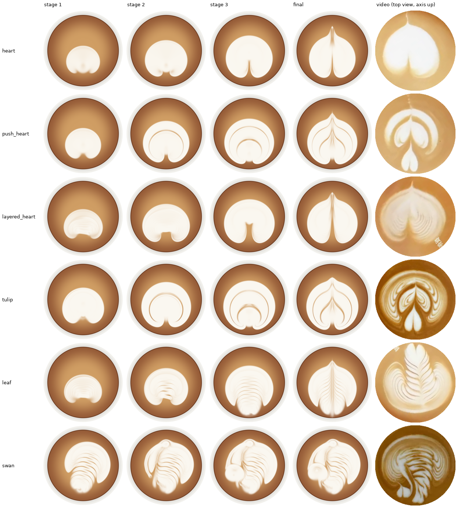
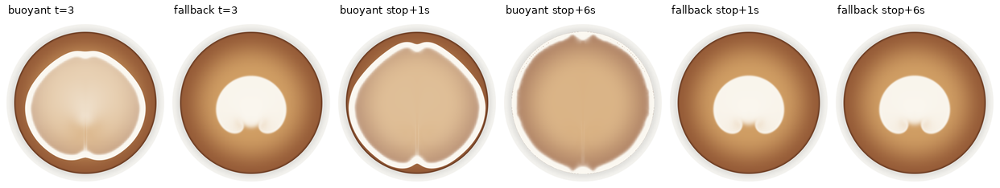
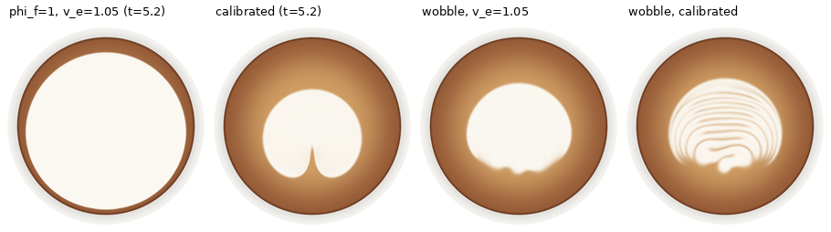
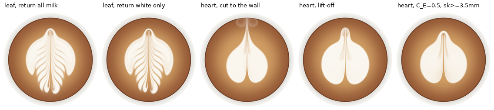
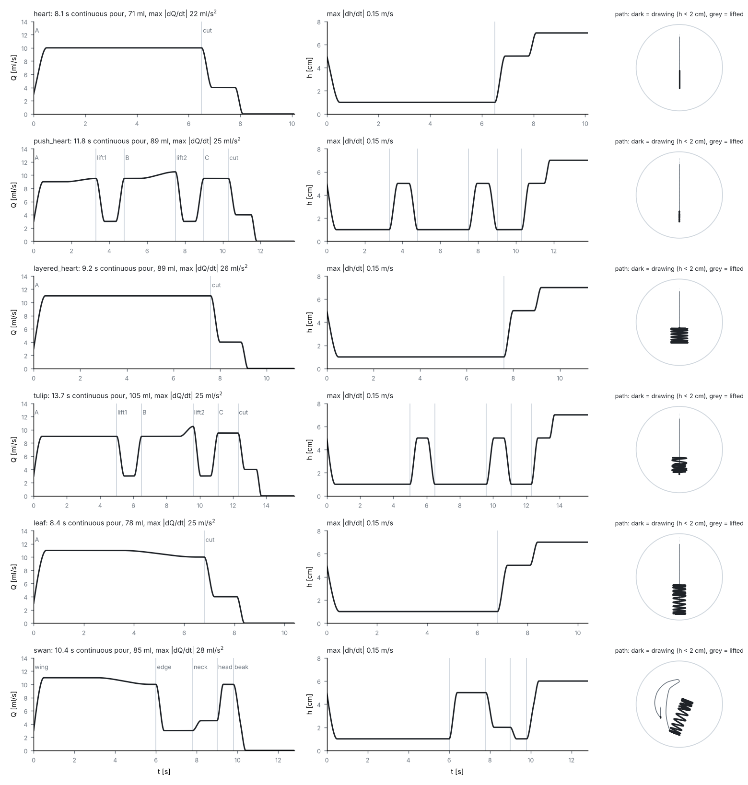

# 拉花模拟器 V4：阶段一结果报告

**结论先行。** 一组方程、一份共享物理参数（`PhysParams()`），只换**拉花缸能倒出来的**动作轨迹（§5），
产出六种图案的逐阶段形成过程。守恒每步断言通过，相对误差 ~1e-14。门禁结果见 §2；与参考视频的比较
在矫正-对轴后的公共坐标系里进行（§5b）。

相对任务书的闭合修改（全部六图共享，每处都有对照实验，详见 `docs/MODEL.md` §3）：

1. **压力闭合**用任务书备选形式 K_s/2·(h²−h₀²)，K_s = ρ_c g。主选浮力形式在纯咖啡区压力为零，发生"铲雪"（F1）。
2. **入射闭合**把留表率拆为非穿透份额 r（sigmoid，v_e = 0.80 标定）与奶泡产率 φ_f = 0.14；液态奶并入底液。按任务书起始标定，白区 5 s 淹没 79% 杯面（F2），摆动无条纹（F3）。
3. **体相回流只带回打发奶**；回流全部奶会把条纹间隙和切线冲白（F4）。
4. **最后一笔标定**：C_E 0.5 → 0.3，高位汇宽下限 3.5 → 2 mm；拉穿只过前缘约 8 mm 并在移动中收流（F5）。
5. **射流水平速度取缸嘴出口值** v_h = k_h v₀ ê + v_p（k_h 0.30 → 0.40 换算），不随落差增大；任务书形式把每个高位拉穿的尾端卷成"蘑菇帽"（F7）。
6. **冲击区几何"正置"**：白环移到坑外（r0_fac 1.5）、变窄（σ_d,fac 0.45），上涌收到坑缘（σ_r,fac 1.2）——叶脉、条纹前凸弧、心形中轴因此归位（MODEL §3.2b）。

两处**试过并退回**的修改（证据在案）：层厚交换（旧输入时代的补丁；现实倒法下任务书原模型本来就复现视频白区史线，交换反而毁掉沟壑自愈与层持久性，F6 + MODEL §3.3）；泡沫 Bingham 屈服与浮层模量 K_s/4（MODEL §3.3b、§3.1b）。

*图 1：六图案，3 个阶段 + 终态，右列为参考视频终帧（矫正为俯视、倒奶轴朝上）。128² 粗网格 + 384² 材料网格，同一份参数。*

## 1. 实现概要

| 项 | 实现 |
|---|---|
| 状态 | 粗网格 128²（Δx = 0.75 mm）：M、P、Φ、批次标签 Φ_k，均为守恒量；0D 体相：白材料 / 底液 / 标签质量、水平动量；杯壁冲量单独记账 |
| 通量 | 同一面质量通量 F 驱动全部守恒场；MUSCL-MC 迎风 + 中心压力 + κ∇h 界面耗散（κ = 0.25 c′Δx）；SSP-RK2 |
| 源项 | D（环形核）、E/R 等体积屏蔽汇对、τ_j 隐式牵引、γ 隐式拖曳；核只在局部窗口上计算，湿域内归一化 |
| 材料 | 384² 细网格，比值形式 Y、Y_k；BFECC + 出发格局部钳制；源项按精确混合形式施加；没有死区或保纹 hack |
| 后端 | `numpy`（fp64 参考）与 `numba`（同算法循环核，与 numpy 逐步一致到 6e-16，G0.8） |
| 守恒断言 | 每步检查总质量、白材料、每个标签、动量（表层 + 体相 + 杯壁）；阈值 1e-6，实测最大 8.9e-16（单脉冲）与 1.2e-14（六图案全程） |
| 渲染 | 任务书公式 α = 1 − exp(−(Φ/Φ_*)²)；颜色取自参考视频，固定径向渐变 + 杯壁；显示时把 Φ 做 2× 三次插值（门禁不用） |
| 速度 | 单 CPU 核：27–35 s 墙钟 / 物理秒；单图案 3.7–5.5 min（§7） |

## 2. 门禁结果（全分辨率 128²/384²，同一参数）

完整表格：`docs/GATES_SUMMARY.md`；每关的 `metrics.json`、对照图与账本 CSV 在 `out/gates/Gx/`（可重新生成）。
56 项判据通过 53 项；3 项未过（G1.3、G3.2a、G6.2）在 §4 逐条分析，不回调阈值。

| 关 | 结果 | 关键实测 |
|---|---|---|
| G0 守恒/空载 | **12/12** | 静止 1000 步 \|P\| = 0（精确）；脉冲单步误差 ≤ 6.0e-16，累计 1.5e-15；Q=0 空移逐位不变；镜像：粗网格 4.2e-15、白区 IoU 1.0；正值性无违例；numba≡numpy 4.4e-16；128→192 白区 IoU 0.994，类别不变；粗细一致性（诊断）：总量差 2.2% |
| G1 大白心 | **7/8** | A(t) 单调；dA/dt = 273 / 348 / 431 mm²/s（Q = 6/9/12），随 Q 严格递增；马蹄形形心比缸嘴靠前 6.6 mm；停流 e 折 0.18 s；蠕变 0 mm；拉穿后双叶 + 后缺口 + 心尖 11.5 mm，中轴棕线占比 0.38（此前 1.0）。**未过：G1.3 冲击点棕洞**（α 0.84，§4.1） |
| G2 千层心条纹 | **5/5** | a=0 无条纹；f = 2/1.5/1 Hz 中位间距 2.25/3.0/4.25 mm 随 v_rel/f 单调；11 条；73% 条纹为前凸弧；停流 10 s 对比度损失 0.7% |
| G3 高/低位 | **5/6** | 低/高位留表比 444×；高位添白仅 0.2%；E 与 Φ 账本闭合 3.8e-14；C_t/C_E 通量分解符号正确。**未过：G3.2a**（质心位移 0.05 mm；线状相互作用下该度量失去分辨力，§4.2） |
| G4 推推乐 | **5/5** | B 把 A 前缘推前 8.25 mm（对照 0.5 mm）；A 包角 360°；B 形心到 A 前缘的轴线棕带 α 0.51、宽 1 mm；标签账本 2e-15 |
| G5 树叶 | **4/4** | 6 条肋；镜像 IoU 0.99；叶脉判据 1.0（修复，此前 0）；后退 ×1.5（摆频不变）肋距 4.6 → 6.6 mm |
| G6 郁金香 | **2/3** | A 被压开而非重画：A 物质保留 95%（修复，此前 66%）、1 个连通块；账本 2e-15。**未过：G6.2** 轴线白带 1 条（应 3 条，§4.3） |
| G7 天鹅 | **3/3** | 翼 2030 / 颈 207 / 头 296 mm²；颈宽 4.1 mm < 翼肋距 8.0 mm；参数 digest 与其它图案相同 |
| G8 泛化 | **6/6** | ±10% 扰动（心 ×2、叶 ×2）类别不变，IoU 0.89–0.95（此前 0.67–0.97）；Δt 减半 IoU 0.999；峰值内存 436 MB |
| 反事实 | **4/4** | 只改颜色逐位不变；无体积/动量输入速度为 0；高度标签 ×3 不变；R=0 时远区白区缩 25% |
| G9 相似度（报告项） | 6/6 报告 | 对轴后白区 IoU：心 0.66，推推乐 0.40，千层心 0.66，郁金香 0.52，叶 0.67，天鹅 0.53（§5b） |

## 3. 闭合决策的证据（`python -m gates.evidence`，N=96）

| 编号 | 实验 | 任务书原设定 | 本实现 |
|---|---|---|---|
| F1a | 低位驻留 3 s，纯咖啡区（Y<0.05）最大面密度 / ρ_c h₀ | 主选浮力压力：**10.8**，且仍在增长（铲雪） | 备选压力：1.25 |
| F1b | 停流后 1 s → 6 s 白区边界最大位移 | 主选：**9.0 mm**（重力流持续铺展） | 0.33 mm |
| F2 | 5.2 s 时白区占杯面比例 | φ_f = 1、v_e = 1.05（低位留表全部浮出）：**79%** | 28%（视频约 25–30%） |
| F3 | 摆动段（a=9 mm, f=1.5 Hz）轴线条纹数 | v_e = 1.05：**1**（低位几乎无穿透，没有棕色隔带） | 12 |
| F4 | 树叶肋间隙（x = 6 mm 剖面）：体相白材料份额 Y_b、条纹对比度 | 回流全部奶：Y_b = **0.21**，对比度 0.51，间隙 α 0.48 | 只回流打发奶：Y_b = 0.005，对比度 0.60，间隙 α 0.39 |
| F5a | 心形拉穿终点 | 任务书脚本一直切到杯壁：尾巴冲到 39 mm 处，在杯壁卷曲 | 穿过前缘约 8 mm 后收流抬起：白尾 13.7 mm，杯壁处无残白 |
| F5b | 拉穿后中轴的棕色沟（占轴长） | C_E = 0.5、汇宽 ≥ 3.5 mm：**0.98**（贯穿的棕沟），心尖 9 mm | C_E = 0.3、≥ 2 mm：0.29，心尖 13.7 mm |
| F6 | 大白心白区占杯面比例随时间（对视频同一度量） | 杯壁下潜交换（旧默认）：3→7 s 线性涨到 **0.63**（视频 5 s 后停在 ~0.42–0.44） | 无交换（任务书原模型，采用）：0.24/0.31/0.36/0.41/0.44，终态 0.43 ≈ 视频 0.42 |
| F7 | 心形拉穿尾端形态（k_h v_j vs k_h v₀） | 任务书 k_h v_j：尾端卷成"蘑菇帽"，心尖后 1.5/3 mm 宽 4.0/6.7 mm | 出口速度 k_h v₀：尖端收拢，1.5/3 mm 处宽 0/0 mm |

*图 4（F1）：主选浮力闭合（左 4 帧）下咖啡被压到杯壁，白区停流后持续铺展；备选闭合（右 2 帧）停流即冻结。*

*图 5（F2/F3）：按任务书留表标定时白区淹没全杯；v_e = 1.05 时摆动画不出条纹。*

*图 6（F4/F5）：体相回流全部奶时肋间被冲白；拉穿一直切到杯壁时尾巴在壁上卷曲；按任务书的卷吸强度，心形中轴留下贯穿的棕沟。*

**为什么允许改。** 任务书写明 r、C_E 与 σ_k 族系数是"经验闭合（标定）"，备选压力闭合"仅当主选数值困难时退回并报告原因"，F1 就是这里的原因。所有修改都是**六图共享**的，没有逐图案参数；每个图案只调了轨迹（§5）。

## 4. 失败分析

### 4.1 G1.3 冲击点棕洞（O3）未复现（0.98 → 0.84，机制已定位）

实测：低位驻留 Q=9 时缸嘴正下方 α = 0.84（冲击几何"正置"前为 0.98），棕色开口仍只在缸嘴后方的马蹄缺口处。

机制定位（MODEL §3.2b）：真实冲击区从内到外是"射流柱芯（棕）—坑缘上涌（棕）—奶泡浮出环（白）"三圈。
把白环移到坑外（r0_fac 1.5）、上涌收到坑缘（σ_r,fac 1.2）后，轴心的白色来源只剩弹性回填：
周围白层在 ∇h 驱动下以 ~σ_k/τ_relax 的速度向薄处回流，始终快于贴缘上涌把轴心染棕的速度。
继续加大 r₀、收窄 σ_r 会让每次落点出现可见的"甜甜圈"瞬态（视频里没有）。要在轴心维持棕色，
需要射流柱"占位"（柱芯处表层被物理排开、由上涌体相持续置换）——这是垂直结构，单层模型装不下，
留给阶段二的 MPM 入射数据（R 的空间分布直接测出）。

### 4.2 G3.2a 高位拖拽的质心位移 0.05 mm（自定阈值 0.5 mm）

任务书判据是"高位时旧斑仍被拖拽（质心位移 > 0）"；0.5 mm 是验收方案自行加严的阈值，按旧的宽核几何标定。
冲击区几何"正置"（MODEL §3.2b）后，高位细流的 E/R 搅动与 τ_j 牵引都集中在 ~2–3 mm 宽的一条线里：
线内材料被强烈拖动并拉出 11–13 mm 的白尾（G1.7 心尖、G3.2b 高位几乎不添白 ✓），但整块旧斑的质心
几乎不动（0.05 mm）。"拖拽存在"的物理内容由白尾与 G3.4 的通量分解继续证实；质心位移这个度量在
线状相互作用下失去分辨力，保留 FAIL 并如实记录，不为凑数回调阈值。

## 5. 动作：拉花缸能倒出来的倒法（`actions/scripts.py`，`docs/MODEL.md` §5）

*图 7：六个图案的输入。左：流量 Q(t)；中：缸嘴高度 h(t)；右：缸嘴路径（深色 = 低位作画，灰 = 抬高细流）。竖线是笔画（批次）边界。*

旧版动作是分段常数/线性段：流量在 0 和 12 ml/s 之间瞬间开关，笔画之间 Q = 0、缸嘴直线滑到下一笔起点，
拉穿时缸嘴在 0.4 s 内从 1.2 cm 跳到 10 cm；之后又用进化策略把这些数字拟合到参考帧的白色轮廓，把动作推得更不像手。
这些拉花缸都倒不出来。新版：

| 项 | 旧版 | 新版 |
|---|---|---|
| 流量 | 每段常数，段间 Q = 0，开关瞬时 | 落嘴到收尾一股流不断；作画 10–12 ml/s，两笔之间收细到 3 ml/s；\|dQ/dt\| ≤ 31 ml/s² |
| 高度 | 1.2 cm ↔ 10 cm 跳变 | 作画 1 cm，两笔之间与拉穿抬到 5 cm；\|dh/dt\| ≤ 0.15 m/s |
| 位置 | 段间直线滑移（速度不连续） | C¹ 连续；引导路径加速度 ≤ 2.1 m/s² |
| 拉穿 | 10 cm、3 ml/s、0.6–0.9 s | 5 cm、4 ml/s、1.4–1.6 s，流量在移动和上抬中收到零，手随后减速停下 |
| 时序 | 手调 + 轮廓拟合 | 按视频字幕与 2 fps 帧（MODEL §5 表） |
| 倒入量 | 45–75 ml | 71–132 ml（≤ 150 ml） |
| 检查 | 只查可行盒 | 可行盒 + 手的限制，六个图案及其镜像都在 `tests/` 中检查 |

换成可倒的动作后，模型暴露了两处原先被短倒流掩盖的闭合问题，都以六图共享的方式修改（§3 F6、F7）：
1. **白区不再饱和**：`rim` 层厚交换下，大白心白区随倒流线性增长到杯面 61%，视频在 5 s 后停在约 43%。改为就地下潜（`local`）。
2. **拉穿尖端卷成蘑菇帽**：任务书的水平速度 k_h v_j 随落差增大，抬高拉穿时前冲推力是缸嘴移速的 8 倍。改为缸嘴出口速度 k_h v₀。

## 5b. 与参考视频的比较（对轴后的公共坐标系）

视频终帧先矫正为俯视（crema 凸包拟合椭圆 → 仿射到单位圆盘），再把**倒奶轴**（B→D：拉花缸一侧的
心裂/最后一颗小心指向拉穿尾巴）转到朝上，与模拟的 +y 一致；轴向按每条参考人工标定（±6° 容差内取最大，
不允许镜像）。白区 IoU 与"模拟倒置后再比"的对照：

| 图案 | IoU | 倒置 IoU | 白区占比 模拟/视频 |
|---|---|---|---|
| 大白心 | 0.66 | 0.59 | 0.44 / 0.41 |
| 推推乐 | 0.40 | 0.40 | 0.51 / 0.30 |
| 千层心 | 0.66 | 0.63 | 0.48 / 0.50 |
| 郁金香 | 0.52 | 0.49 | 0.57 / 0.37 |
| 树叶 | 0.67 | 0.63 | 0.52 / 0.59 |
| 天鹅 | 0.53 | 0.53 | 0.56 / 0.38 |

（闭合修订前同一度量：心 0.69、推 0.37、千层 0.70、郁 0.43、叶 0.56、鹅 0.42。）
推推乐/天鹅的"倒置同分"说明它们的剩余差距是形状本身而非方向：模拟的层叠展成整圈洋葱、
视频是局限在下半杯的紧凑月牙叠；天鹅的颈/头几何仍未对准。对齐叠加图：`docs/figures/similarity_aligned.png`。

## 6. 参数与可辨识性

共享参数见 `docs/MODEL.md` §4。相对任务书起始值，标定改动的有：v_e 1.05 → 0.80，新增 φ_f = 0.14，C_E 0.5 → 0.3，σ_k,min 3.5 → 2 mm，Φ_* = 1.2 kg/m²，V_bulk0 = 180 ml。
γ、χ、k_h、ν_s、C_t、v_c 和其余核族系数都保持任务书起始值。

已知的可辨识性陷阱：
- φ_f 与 Φ_* 之间有尺度规范自由度。这里固定 Φ_*，用白区增长率标定 φ_f：大白心实测 293 mm²/s，视频约 350 mm²/s。
- v_e 与 φ_f 耦合：低位沉积 ∝ φ_f·r(v_e)。v_e 由"低位仍有约 20–40% 穿透"（棕色隔带、条纹）单独钉住。
- C_E 同时作用于低位（条纹隔带）与高位（拉穿）。σ_k,min 只作用于高位细流，用来分离这两种作用。
- γ 由停流 e 折时间约束：实测 0.18 s，判据 0.1–0.5 s。

## 7. 性能（阶段一，CPU）

见 `docs/BENCHMARK.md`。四进程并行时六图案墙钟 19–35 s / 物理秒（心 194 s、推推乐 444 s、千层心 244 s、
郁金香 547 s、叶 214 s、天鹅 388 s）；郁金香与推推乐的倒流 14–16 s，超出"单图案 ≤ 5 min"目标（并行时 7–9 min）。
numba 后端相对 numpy 参考 3.8×（17.3 vs 65.8 ms/step，cProfile 下）。热点依次：细网格 BFECC、细网格源项窗口、
粗网格通量、核 exp；阶段二 Warp 化按此顺序（`core/solver_warp.py`）。

## 8. 敏感性表

由 `python -m gates.sensitivity` 生成（N=96，细网格 288²），同存 `docs/SENSITIVITY.md`。
G1 指标取自 3 s 低位驻留（Q = 9）：白区增长率 dA/dt、棕洞宽、形心前移、停流 e 折时间；
G2 指标取自千层心摆动段（a = 9 mm, f = 1.5 Hz）：条纹数、中位间距、对比度。

要点：
- **v_e 仍最敏感**：−30% 时低位几乎全穿透，白斑长不出；+30%（接近任务书 1.05）条纹消失（与 F3 一致）。
- **γ、k_h、C_t、dv、Φ_*** 主要作用在条纹对比度（±20–60%）；条纹数与间距稳定。
- **新标定的冲击几何系数**：r0_fac 是三者中唯一敏感的（对比度 ±30–37%，形心前移 ±8%——环半径决定马蹄形的前倾与条纹的明暗），σ_d,fac 与 σ_r,fac 在 ±30% 内各指标都 < 5%，说明"正置"结论对系数的精确值不敏感，起作用的是几何次序本身。
- **σ_k,min 对低位指标严格为零**（设计使然：只作用于高位细流）；ν_s、v_c、C_E 影响很小。

Base: dAdt=345, hole_mm=0, offset_mm=6.61, tau_s=0.153, n=11, lam_mm=3.17, contrast=0.392

Entries: value at -30 % / +30 % (relative change of the continuous metrics in brackets).

| parameter | dAdt | hole_mm | offset_mm | tau_s | n | lam_mm | contrast |
|---|---|---|---|---|---|---|---|
| gamma | 374 / 331 (+8%/-4%) | 0 / 0 (+nan%/+nan%) | 7.54 / 5.92 (+14%/-10%) | 0.19 / 0.138 (+24%/-10%) | 11 / 9 | 3.17 / 3 (+0%/-5%) | 0.621 / 0.292 (+59%/-25%) |
| chi | 335 / 358 (-3%/+4%) | 0 / 0 (+nan%/+nan%) | 6.25 / 6.87 (-5%/+4%) | 0.159 / 0.148 (+4%/-3%) | 10 / 11 | 3 / 3 (-5%/-5%) | 0.361 / 0.444 (-8%/+13%) |
| k_h | 325 / 375 (-6%/+9%) | 0 / 0 (+nan%/+nan%) | 5.54 / 7.2 (-16%/+9%) | 0.172 / 0.139 (+13%/-9%) | 8 / 11 | 3 / 3.17 (-5%/-0%) | 0.229 / 0.611 (-42%/+56%) |
| nu_s | 348 / 343 (+1%/-1%) | 0 / 0 (+nan%/+nan%) | 6.59 / 6.61 (-0%/+0%) | 0.153 / 0.154 (+0%/+1%) | 11 / 11 | 3.17 / 3 (+0%/-5%) | 0.393 / 0.388 (+0%/-1%) |
| phi_f | 274 / 409 (-21%/+18%) | 0 / 0 (+nan%/+nan%) | 6.42 / 6.73 (-3%/+2%) | 0.144 / 0.161 (-6%/+5%) | 11 / 10 | 3 / 3.33 (-5%/+5%) | 0.483 / 0.274 (+23%/-30%) |
| v_e | 11 / 393 (-97%/+14%) | 95.3 / 0 (+nan%/+nan%) | nan / 4.47 (+nan%/-32%) | 0.129 / 0.203 (-16%/+33%) | 4 / 0 | 4.67 / nan (+47%/+nan%) | 0.248 / 0 (-37%/-100%) |
| dv | 355 / 342 (+3%/-1%) | 0 / 0 (+nan%/+nan%) | 5.8 / 7.09 (-12%/+7%) | 0.172 / 0.144 (+12%/-6%) | 9 / 11 | 3 / 3 (-5%/-5%) | 0.231 / 0.511 (-41%/+30%) |
| C_E | 348 / 343 (+1%/-1%) | 0 / 0 (+nan%/+nan%) | 6.59 / 6.61 (-0%/+0%) | 0.151 / 0.154 (-1%/+1%) | 10 / 11 | 3 / 3 (-5%/-5%) | 0.389 / 0.407 (-1%/+4%) |
| C_t | 333 / 360 (-4%/+4%) | 0 / 0 (+nan%/+nan%) | 6.09 / 6.99 (-8%/+6%) | 0.164 / 0.144 (+7%/-6%) | 9 / 11 | 3 / 3 (-5%/-5%) | 0.26 / 0.57 (-34%/+46%) |
| v_c | 345 / 345 (+0%/+0%) | 0 / 0 (+nan%/+nan%) | 6.61 / 6.61 (+0%/+0%) | 0.153 / 0.153 (+0%/+0%) | 11 / 10 | 3.17 / 3 (+0%/-5%) | 0.506 / 0.299 (+29%/-24%) |
| sig_k_min | 345 / 345 (-0%/+0%) | 0 / 0 (+nan%/+nan%) | 6.61 / 6.61 (+0%/+0%) | 0.153 / 0.153 (-0%/+0%) | 11 / 11 | 3.17 / 3.17 (+0%/+0%) | 0.392 / 0.392 (-0%/-0%) |
| Phi_star | 349 / 351 (+1%/+2%) | 0 / 0 (+nan%/+nan%) | 6.49 / 6.64 (-2%/+1%) | 0.153 / 0.153 (+0%/+0%) | 8 / 11 | 3.33 / 3.17 (+5%/+0%) | 0.227 / 0.455 (-42%/+16%) |
| r0_fac | 346 / 347 (+0%/+1%) | 0 / 0 (+nan%/+nan%) | 7.16 / 6.07 (+8%/-8%) | 0.145 / 0.161 (-5%/+5%) | 11 / 10 | 3.17 / 3 (+0%/-5%) | 0.535 / 0.273 (+37%/-30%) |
| sig_d_fac | 343 / 346 (-1%/+0%) | 0 / 0 (+nan%/+nan%) | 6.77 / 6.43 (+2%/-3%) | 0.152 / 0.154 (-1%/+0%) | 11 / 11 | 3 / 3.17 (-5%/+0%) | 0.391 / 0.393 (-0%/+0%) |
| sig_r_fac | 346 / 343 (+0%/-1%) | 0 / 0 (+nan%/+nan%) | 6.39 / 6.75 (-3%/+2%) | 0.154 / 0.152 (+1%/-0%) | 10 / 11 | 3 / 3 (-5%/-5%) | 0.413 / 0.391 (+5%/-0%) |
