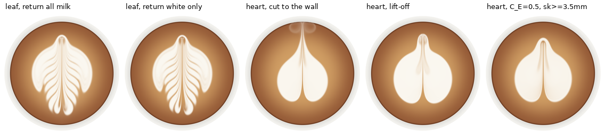

# 拉花模拟器 V4：阶段一结果报告

**结论先行。** 一组方程、一份共享物理参数（`PhysParams()`），只换动作轨迹，产出了六种图案的逐阶段形成过程：
大白心、推推乐、千层心、郁金香、树叶、天鹅（图 1）。守恒每步断言通过，相对误差 ≤ 1.2e-14。
门禁共 56 项判据，**54 项通过**；未通过的是 G1.3（冲击点棕洞）和 G3.2a（高位拖拽位移 0.32 mm，低于自定阈值 0.5 mm），见 §4。

相对任务书，模型有三处闭合修改，另有两个经验参数的标定。每一处都有反证实验（§3），说明见 `docs/MODEL.md` §3：

1. **压力闭合**改用任务书的备选形式 K_s/2·(h²−h₀²)，K_s = ρ_c g，没有新增可调参数。主选形式在纯咖啡区压力为零，咖啡会被"铲雪"堆到 10.8 ρ_c h₀，停流后 5 s 边界仍移动 9 mm。
2. **入射闭合**把 r 拆成非穿透份额 r（sigmoid，v_e 标定为 0.80）与奶泡产率 φ_f = 0.14（D = φ_f r ṁ K_d）。按任务书标定，5 s 时白区就淹没 79% 的杯面。
3. **体相回流**只带回体相中的打发奶（白材料），沉下去的液态奶并入底液。按任务书写法，R 会把 Y_b ≈ 0.2 的"奶"当作白色带回，条纹间隙和切割线都被冲白。
4. **最后一笔（高位拉穿）**的标定：C_E 0.5 → 0.3，高位细流汇宽下限 3.5 → 2 mm。按起始值，拉穿后中轴留下贯穿的棕色沟（占轴长 98%），尖尾短；标定后沟闭合到 29%，并拖出 13.7 mm 的白尾。

*图 1：六图案，3 个阶段 + 终态，右列为参考视频终帧（视频为斜视，方向不同）。128² 粗网格 + 384² 材料网格，同一份参数。*

## 1. 实现概要

| 项 | 实现 |
|---|---|
| 状态 | 粗网格 128²（Δx = 0.75 mm）：M、P、Φ、批次标签 Φ_k，均为守恒量；0D 体相：白材料 / 底液 / 标签质量、水平动量；杯壁冲量单独记账 |
| 通量 | 同一面质量通量 F 驱动全部守恒场；MUSCL-MC 迎风 + 中心压力 + κ∇h 界面耗散（κ = 0.25 c′Δx）；SSP-RK2 |
| 源项 | D（环形核）、E/R 等体积屏蔽汇对、τ_j 隐式牵引、γ 隐式拖曳；核只在局部窗口上计算，湿域内归一化 |
| 材料 | 384² 细网格，比值形式 Y、Y_k；BFECC + 出发格局部钳制；源项按精确混合形式施加；没有死区或保纹 hack |
| 后端 | `numpy`（fp64 参考）与 `numba`（同算法循环核，与 numpy 逐步一致到 6e-16，G0.8） |
| 守恒断言 | 每步检查总质量、白材料、每个标签、动量（表层 + 体相 + 杯壁）；阈值 1e-6，实测最大 8.9e-16（单脉冲）与 1.2e-14（六图案全程） |
| 渲染 | 任务书公式 α = 1 − exp(−(Φ/Φ_*)²)；颜色取自参考视频，固定径向渐变 + 杯壁；显示时把 Φ 做 2× 三次插值（门禁不用） |
| 速度 | 单 CPU 核：27–35 s 墙钟 / 物理秒；单图案 3.7–5.5 min（§7） |

## 2. 门禁结果（全分辨率 128²/384²，同一参数）

完整表格：`docs/GATES_SUMMARY.md`；每关的 `metrics.json`、对照图与账本 CSV 在 `out/gates/Gx/`（可重新生成）。下表列出各关判据与实测值。

| 关 | 结果 | 关键实测 |
|---|---|---|
| G0 守恒/空载 | **12/12** | 静止 1000 步 \|P\| = 0（精确）；脉冲单步误差 ≤ 8.9e-16，累计 9.7e-16；Q=0 空移逐位不变；镜像：粗网格 4.2e-15、白区 IoU 1.0；正值性无违例；numba≡numpy 6.3e-16；128→192 白区 IoU 0.990，类别不变；粗细一致性（诊断）：总量差 1.5% |
| G1 大白心 | **7/8** | A(t) 单调；dA/dt = 268 / 356 / 389 mm²/s（Q = 6/9/12），随 Q 递增；马蹄形形心比缸嘴靠前 7.8 mm；停流后速度 e 折时间 0.18 s；蠕变（停流后 1→6 s）0.25 mm；切割后双叶 + 后部缺口 + 心尖 13.8 mm、单连通；低位穿过对照组的切割线占比 0。**未过：G1.3 冲击点棕洞**（§4.1） |
| G2 千层心条纹 | **5/5** | a=0 无条纹；f = 1 / 1.5 / 2 Hz 时分别 9 / 12 / 13 条，中位间距 4.0 / 3.0 / 2.4 mm，随 v_rel/f 单调；64% 的条纹为前凸弧；10 s 对比度损失 1.1% |
| G3 高/低位 | **5/6** | 低/高位留表比 449×；高位留表量只有低位的 0.2%；E 移除与 Φ 账本相差 2.6e-14；C_t=0 时拖曳通量降到 0.3%，C_E=0 时收拢通量消失。**未过：G3.2a**，高位穿过时旧斑质心只被拖动 0.32 mm（< 0.5 mm）（§4.2） |
| G4 推推乐 | **5/5** | B 把 A 前缘推前 3.25 mm（对照组 0.0）；A 成月牙，包角 220°；A/B 之间棕色隔带宽 5.25 mm；A 标签账本 1.1e-15 |
| G5 树叶 | **4/4** | 8 条肋；镜像 IoU 0.81；叶脉判据 1.0；退速 ×1.5 时肋距 5.6 → 5.8 mm |
| G6 郁金香 | **3/3** | A 被压开而非重画（A 物质 1 个连通块，表层 A 量保留 101%）；轴线上 3 条白带，标签由后到前依次为 C、B、A；A 账本 7e-15 |
| G7 天鹅 | **3/3** | 翼 1525、颈 175、头 186 mm²；颈宽 2.8 mm < 翼肋间距 7.9 mm；参数 digest 与其它图案相同 |
| G8 泛化 | **6/6** | ±10% 扰动（心 ×2、叶 ×2）类别不变，IoU 0.77–0.97；Δt 减半 IoU 0.998；峰值内存 456 MB |
| 反事实 | **4/4** | CF1：只改颜色（标签场）时动力学逐位不变，无体积/动量输入时速度为 0；CF2：高度标签 ×3 而 (Q, v_j) 不变时输出逐位相同；CF3：R=0（裸汇）时白区 1727 → 1424 mm²，远离切割线处（\|x\|>10 mm）缩小 32%，即"整图均匀收缩"的错误模式 |

*图 2（G3）：同一路径只改落差。低位画出白线，高位切出带白尾的心形（O1 双模式）。C_t=0 时无拖曳；C_E=0 时不收拢。*

*图 3（G2）：绘图仪关系。a=0 无条纹；f = 1 → 2 Hz 时条纹变细；停流 10 s 后条纹不变（右）。*

## 3. 闭合决策的证据（`python -m gates.evidence`，N=96）

| 编号 | 实验 | 任务书原设定 | 本实现 |
|---|---|---|---|
| F1a | 低位驻留 3 s，纯咖啡区（Y<0.05）最大面密度 / ρ_c h₀ | 主选浮力压力：**10.8**，且仍在增长（铲雪） | 备选压力：1.25 |
| F1b | 停流后 1 s → 6 s 白区边界最大位移 | 主选：**9.0 mm**（重力流持续铺展） | 0.33 mm |
| F2 | 5.2 s 时白区占杯面比例 | φ_f = 1、v_e = 1.05（低位留表全部浮出）：**79%** | 28%（视频约 25–30%） |
| F3 | 摆动段（a=9 mm, f=1.5 Hz）轴线条纹数 | v_e = 1.05：**1**（低位几乎无穿透，没有棕色隔带） | 12 |
| F4 | 树叶肋间隙（x = 6 mm 剖面）：体相白材料份额 Y_b、条纹对比度 | 回流全部奶：Y_b = **0.21**，对比度 0.51，间隙 α 0.48 | 只回流打发奶：Y_b = 0.005，对比度 0.60，间隙 α 0.39 |
| F5a | 心形拉穿终点 | 任务书脚本一直切到杯壁：尾巴冲到 39 mm 处，在杯壁卷曲 | 穿过前缘约 8 mm 后收流抬起：白尾 13.7 mm，杯壁处无残白 |
| F5b | 拉穿后中轴的棕色沟（占轴长） | C_E = 0.5、汇宽 ≥ 3.5 mm：**0.98**（贯穿的棕沟），心尖 9 mm | C_E = 0.3、≥ 2 mm：0.29，心尖 13.7 mm |

*图 4（F1）：主选浮力闭合（左 4 帧）下咖啡被压到杯壁，白区停流后持续铺展；备选闭合（右 2 帧）停流即冻结。*

*图 5（F2/F3）：按任务书留表标定时白区淹没全杯；v_e = 1.05 时摆动画不出条纹。*

*图 6（F4/F5）：体相回流全部奶时肋间被冲白；拉穿一直切到杯壁时尾巴在壁上卷曲；按任务书的卷吸强度，心形中轴留下贯穿的棕沟。*

**为什么允许改。** 任务书写明 r、C_E 与 σ_k 族系数是"经验闭合（标定）"，备选压力闭合"仅当主选数值困难时退回并报告原因"，F1 就是这里的原因。所有修改都是**六图共享**的，没有逐图案参数；每个图案只调了轨迹（§5）。

## 4. 失败分析

### 4.1 G1.3 冲击点棕洞（O3）未复现

实测：低位驻留 Q=9 时缸嘴正下方 α = 0.94，马蹄形的棕色开口在缸嘴后方 4.25 mm 处。白斑的整体形态是对的（前开口马蹄形、形心靠前 7.8 mm），
但"冲击点本身持续为棕色"没有出现。

机制定位：
1. 按任务书参数，环形核没有真正的洞：r₀/σ_d = 0.8 r < 1，中心权重 ≥ 0.53。
2. E 按当地成分移除，只会让层变薄、不改变 Y。弹性压力随即把周围的白色回填到冲击点。
3. u_d 的前向推力把环形沉积的后半部分推过冲击点。

已尝试（N=96，均为共享参数改动；冲击点 α 依次为）：r0_fac 0.6 → 1.0 → 1.3 时 0.93 / 0.90 / 0.87；C_E = 1.0 时 0.81；v_e = 0.7、C_E = 1.5 时 0.78，代价是白区增长率降到原来的 20%；χ = 0.15 时 0.97。都达不到 α < 0.5。

判断：要在冲击点维持棕色，需要一个在冲击点**改变成分**的项，例如中心集中的体相上涌或射流柱占位。这属于入射闭合形式的改动，留待阶段二由 MPM 入射数据确定 R 的空间分布。

### 4.2 G3.2a 高位拖拽位移 0.32 mm（自定阈值 0.5 mm）

任务书判据是"高位时旧斑仍被拖拽（质心位移 > 0）"，实测 0.32 mm 满足它，但没有达到验收方案里自己加严的 0.5 mm。原因是 §3 F5b 的标定：
卷吸减弱、高位汇变窄（2 mm）之后，拖拽集中在一条细带里，被拉出的是细长的白尾而不是整团旧斑，旧斑整体质心移动较小。
同一标定让心尖从 9 mm 增长到 13.7 mm，中轴棕沟从 98% 降到 29%。这是有意的取舍：最后一笔的形态优先。

### 4.3 与参考视频的差距（非门禁）

- **大白心**的中轴还留有一条浅缝（29% 轴长），真实心形完全闭合。
- **天鹅**的颈比视频细（2.8 mm）且较淡；头与翼根之间有一条白色连接。
- **推推乐 / 郁金香**每层的两叶偏长，像郁金香的花瓣；真实推推乐每层更圆。
- **整体尺寸**：终态白区占杯面 27–34%，视频中约 40–60%；要更大需要更大的倒入量或更高的 φ_f。

### 4.4 单层模型的边界（记录，不硬修）

- 冲击点棕洞（§4.1）可能需要垂直结构：射流柱与上涌环。
- 细网格比值形式的材料与粗网格账本在总量上相差 1.5%（G0.9），限制后的 L1 差为 6.6%。守恒账本以粗网格为准，图案用细网格。严格守恒的 remap（任务书方案 b）可以消除这一差异。

## 5. 动作轨迹调整记录（只改轨迹，物理参数不变）

所有拉穿都改为 `lift_cut`：高位（10 cm）、小流量（3–3.5 ml/s）、快速（0.6–0.9 s），穿过图案前缘约 8 mm 后，在最后 0.15–0.3 s 把流量收到零。

| 图案 | 任务书起始值 | 调整 | 原因 |
|---|---|---|---|
| 大白心 | 低位倒到 5.2 s；切割 (0,−4)→(0,40)，1.4 s，Q 6 | 低位倒到 6.0 s；拉穿 (0,−6)→(0,32)，0.7 s，Q 3 | 白斑更大；切到杯壁会把尾巴卷在壁上（F5a） |
| 推推乐 | 三点 1.3/1.1/0.9 s，点 2/3 为 Q 14、h 1.3 cm；切割至 40 mm | 三点 1.8/1.5/1.3 s，点 2/3 为 Q 12、h 1.0 cm；拉穿 (0,−30)→(0,30)，0.6 s，Q 3 | Q=14 时 v₀ 抬高 v_j，r 降到 0.35，点画不出白斑；慢而强的切割会把每层拉成长瓣 |
| 千层心 | 由 (0,−24) 前移到 (0,20)，a 7.5 mm，f 2 Hz | 由 (0,−4) 后退到 (0,−20)，a 9 mm，f 1.5 Hz；拉穿 (0,−12)→(0,30) | 前移时射流会穿过自己刚画的图案并把它抹掉（保留为 `layered_heart(variant=1)`）；后退 + 摆动正是视频中"摆动的纹路形成半圆形"的过程 |
| 郁金香 | 三段 2.4/1.6/0.9 s；切割至 40 mm | 三段 2.8/2.0/1.2 s，点 3 为 h 1.0 cm；拉穿 (0,−30)→(0,32)，0.6 s，Q 3 | 同推推乐 |
| 树叶 | 切割 (0,−34)→(0,40)，1.4 s | 拉穿 (0,−34)→(0,32)，0.9 s，Q 3.5 | 拉出叶柄，不撞杯壁 |
| 天鹅 | 颈：Q 8, h 1.8 cm, 1.4 s，弧到 1.4π；头 (−12,−26)；微切 (−14,−32)→(−2,−8) | 颈：Q 5, h 2.5 cm, 0.8 s，弧到 1.22π；头 (−18,−17)；鹅嘴一笔 (−16,−14)→(−22,−26)，缸嘴沿运动方向 | 颈原来太宽；原来的头紧挨翼根，原微切把头拖进翼区；拉穿时射流的水平动量沿缸嘴方向 ê，缸嘴必须顺着这一笔 |

所有轨迹都在可行域内（`actions.scripts.check_feasible` 全部通过），总注入量 52–75 ml。

## 6. 参数与可辨识性

共享参数见 `docs/MODEL.md` §4。相对任务书起始值，标定改动的有：v_e 1.05 → 0.80，新增 φ_f = 0.14，C_E 0.5 → 0.3，σ_k,min 3.5 → 2 mm，Φ_* = 1.2 kg/m²，V_bulk0 = 180 ml。
γ、χ、k_h、ν_s、C_t、v_c 和其余核族系数都保持任务书起始值。

已知的可辨识性陷阱：
- φ_f 与 Φ_* 之间有尺度规范自由度。这里固定 Φ_*，用白区增长率标定 φ_f：大白心实测 293 mm²/s，视频约 350 mm²/s。
- v_e 与 φ_f 耦合：低位沉积 ∝ φ_f·r(v_e)。v_e 由"低位仍有约 20–40% 穿透"（棕色隔带、条纹）单独钉住。
- C_E 同时作用于低位（条纹隔带）与高位（拉穿）。σ_k,min 只作用于高位细流，用来分离这两种作用。
- γ 由停流 e 折时间约束：实测 0.18 s，判据 0.1–0.5 s。

## 7. 性能（阶段一，CPU）

见 `docs/BENCHMARK.md`。无剖析器时，六图案的墙钟耗时 / 物理秒（4 个进程并行，单核/进程）：
心 29.0、推推乐 26.7、千层心 30.0、郁金香 29.9、叶 33.3、天鹅 34.6，单图案 3.7–5.5 min。
天鹅与郁金香略超任务书"单图案 ≤ 5 min"的目标。单进程独占运行时约快 15%（此前测得 23–31 s / 物理秒）。
numba 后端相对 numpy 参考加速 3.1×（cProfile 下 29.5 vs 90.1 ms/step）。热点（numba 后端）：细网格 BFECC 38%、细网格源项窗口 27%、粗网格通量 23%、核 exp 7%。阶段二的 Warp 化按这个顺序进行（`core/solver_warp.py`）。

## 8. 敏感性表

由 `python -m gates.sensitivity` 生成（N=96，细网格 288²），也存为 `docs/SENSITIVITY.md`。
G1 指标取自 3 s 低位驻留（Q = 9 ml/s）：白区增长率、棕洞宽度、形心前移量、停流 e 折时间。G2 指标取自千层心摆动段（a = 9 mm, f = 1.5 Hz）：条纹数、中位间距、对比度。

要点：
- **v_e 最敏感**。−30% 时低位几乎全部穿透，白斑长不出来。此时 hole_mm = 95 只是"整片都是棕色"的读数，没有物理意义。
  +30%（接近任务书值 1.05）时条纹消失，与 F3 一致。
- **γ、k_h、C_t、dv、Φ_*** 主要影响条纹对比度（±20–60%）；条纹数和间距基本稳定。γ 同时决定冻结时间 τ（0.19 / 0.13 s，都在 0.1–0.5 s 内）。
  Φ_* −30% 时整体更白，条纹间的棕色隔带被阈值部分吞掉（12 → 8 条），反映出 Φ_* 与 φ_f 之间的规范耦合。
- **σ_k,min 对这些低位指标的影响为零**，这是设计使然：它只作用于高位细流，只影响最后一笔（F5b）。
- **ν_s、v_c、C_E** 在 ±30% 范围内对 G1/G2 指标影响很小；C_E 主要靠 F5b（最后一笔）约束。

Base: dAdt=354, hole_mm=0, offset_mm=7.76, tau_s=0.15, n=12, lam_mm=3, contrast=0.406

Entries: value at -30 % / +30 % (relative change of the continuous metrics in brackets).

| parameter | dAdt | hole_mm | offset_mm | tau_s | n | lam_mm | contrast |
|---|---|---|---|---|---|---|---|
| gamma | 393 / 330 (+11%/-7%) | 0 / 0 (+nan%/+nan%) | 8.78 / 7.08 (+13%/-9%) | 0.192 / 0.128 (+28%/-15%) | 12 / 12 | 3.33 / 3 (+11%/+0%) | 0.647 / 0.253 (+60%/-38%) |
| chi | 338 / 370 (-5%/+4%) | 0 / 0 (+nan%/+nan%) | 7.52 / 7.94 (-3%/+2%) | 0.152 / 0.148 (+1%/-1%) | 12 / 12 | 3 / 3 (+0%/+0%) | 0.355 / 0.461 (-12%/+14%) |
| k_h | 316 / 389 (-11%/+10%) | 0 / 0 (+nan%/+nan%) | 6.86 / 8.26 (-12%/+6%) | 0.151 / 0.149 (+1%/-1%) | 7 / 12 | 3.33 / 3 (+11%/+0%) | 0.229 / 0.626 (-44%/+54%) |
| nu_s | 357 / 352 (+1%/-0%) | 0 / 0 (+nan%/+nan%) | 7.72 / 7.8 (-1%/+0%) | 0.151 / 0.15 (+1%/+0%) | 12 / 12 | 3 / 3 (+0%/+0%) | 0.412 / 0.399 (+2%/-2%) |
| phi_f | 282 / 415 (-20%/+17%) | 0 / 0 (+nan%/+nan%) | 7.63 / 7.91 (-2%/+2%) | 0.148 / 0.155 (-1%/+3%) | 12 / 11 | 3 / 3.17 (+0%/+6%) | 0.535 / 0.261 (+32%/-36%) |
| v_e | 0 / 384 (-100%/+9%) | 95.3 / 0 (+nan%/+nan%) | nan / 5.63 (+nan%/-27%) | 0.153 / 0.159 (+2%/+7%) | 4 / 0 | 3.67 / nan (+22%/+nan%) | 0.322 / 0 (-21%/-100%) |
| dv | 362 / 352 (+2%/-1%) | 0 / 0 (+nan%/+nan%) | 7.04 / 8.19 (-9%/+6%) | 0.152 / 0.149 (+2%/-0%) | 11 / 12 | 3.33 / 3 (+11%/+0%) | 0.244 / 0.511 (-40%/+26%) |
| C_E | 362 / 347 (+2%/-2%) | 0 / 0 (+nan%/+nan%) | 7.69 / 7.83 (-1%/+1%) | 0.15 / 0.149 (+0%/-0%) | 12 / 12 | 3 / 3 (+0%/+0%) | 0.383 / 0.428 (-6%/+6%) |
| C_t | 335 / 374 (-6%/+6%) | 0 / 0 (+nan%/+nan%) | 7.28 / 8.14 (-6%/+5%) | 0.149 / 0.15 (-1%/+0%) | 11 / 12 | 3 / 3 (+0%/+0%) | 0.237 / 0.578 (-42%/+42%) |
| v_c | 354 / 354 (-0%/-0%) | 0 / 0 (+nan%/+nan%) | 7.76 / 7.76 (+0%/+0%) | 0.15 / 0.15 (-0%/-0%) | 12 / 12 | 3 / 3 (+0%/+0%) | 0.433 / 0.38 (+7%/-6%) |
| sig_k_min | 354 / 354 (+0%/+0%) | 0 / 0 (+nan%/+nan%) | 7.76 / 7.76 (+0%/+0%) | 0.15 / 0.15 (+0%/+0%) | 12 / 12 | 3 / 3 (+0%/+0%) | 0.406 / 0.406 (+0%/+0%) |
| Phi_star | 354 / 356 (-0%/+0%) | 0 / 0 (+nan%/+nan%) | 7.59 / 7.99 (-2%/+3%) | 0.15 / 0.15 (+0%/+0%) | 8 / 12 | 4 / 3 (+33%/+0%) | 0.239 / 0.492 (-41%/+21%) |

