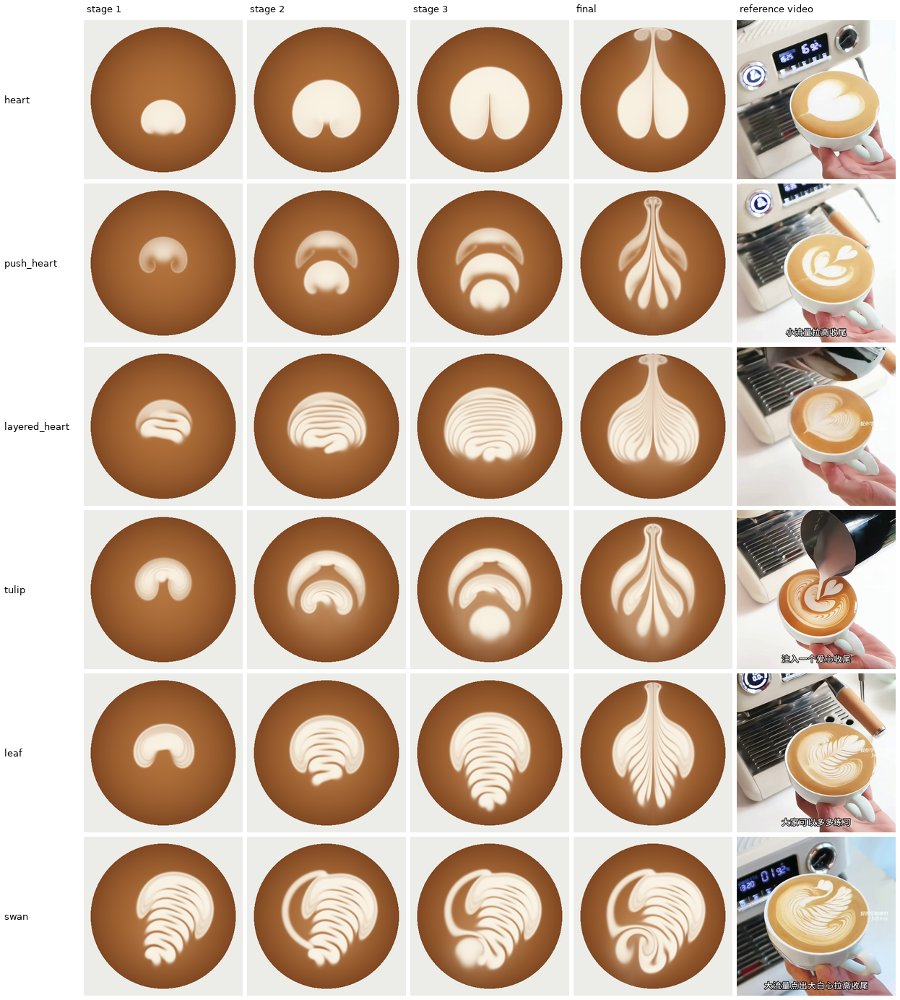
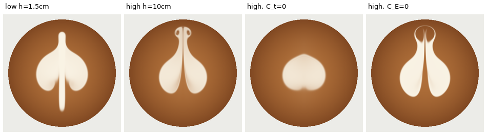
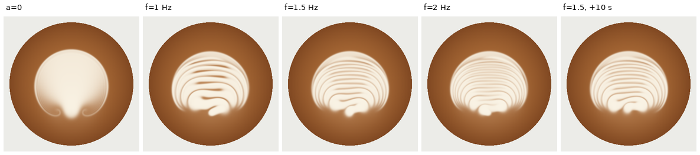
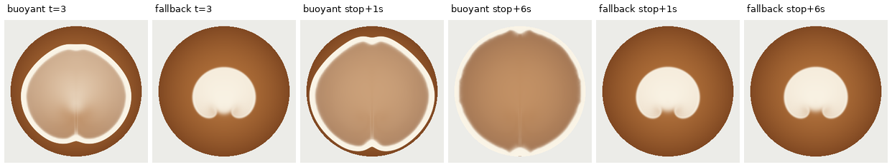
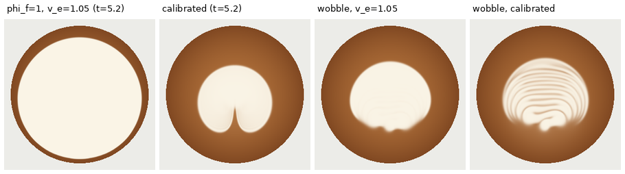
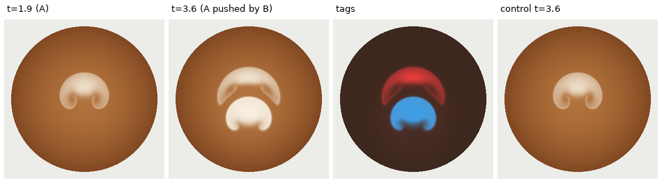

# 拉花模拟器 V4：阶段一结果报告

**结论先行。** 一组方程、一份共享物理参数（`PhysParams()`，digest `4512db61f9c2`），只换动作轨迹，产出了六种图案的逐阶段形成过程：
大白心、推推乐、千层心、郁金香、树叶、天鹅（图 1）。守恒每步断言通过，相对误差 ≤ 1e-14。
门禁共 56 项判据，53 项通过；3 项未通过（G1.3 冲击点棕洞、G2.5 条纹曲率、G4.2 月牙包角），见 §4。

为此对任务书模型做了两处闭合修改。每一处都有反证实验（§3），并在 `docs/MODEL.md` 中逐条说明：

1. **压力闭合**改用任务书的备选形式 K_s/2·(h²−h₀²)，K_s = ρ_c g，不引入新的可调参数。主选闭合在纯咖啡区没有压力，会导致咖啡"铲雪"无界堆积（9.8 ρ_c h₀），并使奶泡持续蠕变：停流后 5 s 内边界移动 8 mm。
2. **入射闭合**里的 r 拆成两部分：非穿透份额 r（sigmoid，v_e 标定为 0.80），以及奶泡产率 φ_f = 0.14（D = φ_f r ṁ K_d）。按任务书标定（低位 r≈0.9 全部浮出）时，白区在 5 s 内淹没 79% 的杯面，而视频白区增长率约为 350 mm²/s。

*图 1：六图案，3 个阶段 + 终态，右列为参考视频终帧（视频视角为斜视，方向不同）。128² 粗网格 + 384² 材料网格，同一份参数。*

## 1. 实现概要

| 项 | 实现 |
|---|---|
| 状态 | 粗网格 128²（Δx = 0.75 mm）：M、P、Φ、批次标签 Φ_k，均为守恒量；0D 体相：奶/咖啡/标签质量、水平动量；杯壁冲量单独记账 |
| 通量 | 同一面质量通量 F 驱动全部守恒场；MUSCL-MC 迎风 + 中心压力 + κ∇h 界面耗散（κ = 0.25 c′Δx）；SSP-RK2 |
| 源项 | D（环形核）、E/R 等体积屏蔽汇对（高斯，σ_r = 2.5σ_k）、τ_j 隐式牵引、γ 隐式拖曳，核只在局部窗口上计算，湿域内归一化 |
| 材料 | 384² 细网格，比值形式 Y、Y_k；BFECC + 出发格局部钳制；源项按精确混合形式施加；没有死区或保纹 hack |
| 后端 | `numpy`（fp64 参考）与 `numba`（同算法循环核，与 numpy 逐步一致到 6e-16，G0.8） |
| 守恒断言 | 每步检查总质量、奶材料、每个标签、动量（表层 + 体相 + 杯壁）；阈值 1e-6，实测最大 8.9e-16（单脉冲）与 6.7e-15（六图案全程） |
| 速度 | 单 CPU 核：23–31 s 墙钟 / 物理秒；单图案 3.2–5.2 min（表 3） |

## 2. 门禁结果（全分辨率 128²/384²，同一参数）

完整表格：`out/gates/summary.md`；每关的 `metrics.json`、对照图与账本 CSV 在 `out/gates/Gx/`。下表列出各关判据与实测值。

| 关 | 结果 | 关键实测 |
|---|---|---|
| G0 守恒/空载 | **12/12** | 静止 1000 步 \|P\| = 0（精确）；脉冲单步误差 ≤ 8.9e-16，累计 2.2e-15；Q=0 空移逐位不变；镜像：粗网格 3.5e-14、白区 IoU 1.0；正值性无违例；numba≡numpy 6.4e-16；128→192 白区 IoU 0.992，类别不变；粗细一致性（诊断）：总量差 1.4% |
| G1 大白心 | **7/8** | A(t) 单调；dA/dt = 263 / 347 / 390 mm²/s（Q = 6/9/12），随 Q 递增；马蹄形形心比缸嘴靠前 7.9 mm；停流后速度 e 折时间 0.18 s；蠕变（停流后 1→6 s）0.0 mm；切割后双叶 + 后部缺口 + 心尖 19.8 mm、单连通；低位穿过对照组的切割线占比 0（心形为 0.41）。**未过：G1.3 冲击点棕洞**（§4.1） |
| G2 千层心条纹 | **4/5** | a=0 无条纹；a=9 mm、f=1.5 Hz 时 12 条；中位间距 2.5 / 3.0 / 4.1 mm（f = 2 / 1.5 / 1 Hz），随 v_rel/f 单调；10 s 对比度损失 0.3%。**未过：G2.5 曲率**，0.55 < 0.6（§4.2） |
| G3 高/低位 | **6/6** | 留表比 449×；高位拖动旧白 1.1 mm，留表量只有低位的 0.2%；E 移除与 Φ 账本相差 5.9e-16；C_t=0 时拖曳通量降到 0.1%，C_E=0 时收拢通量降到 0.9% |
| G4 推推乐 | **4/5** | B 把 A 前缘推前 3.3 mm（对照组 0.0）；A/B 之间棕色隔带 α_min 0.04、宽 1.25 mm；A 标签账本 1.2e-14。**未过：G4.2 月牙包角** 140° < 180°（§4.3） |
| G5 树叶 | **4/4** | 8 条肋；镜像 IoU 0.87；叶脉判据 1.0；退速 ×1.5 时肋距 5.6 → 6.8 mm |
| G6 郁金香 | **3/3** | A 被压开而非重画：4.9 s 时表层 A 量为第一段结束时的 140%（R 把体相中带 A 标签的奶带回表层），A 物质 1 个连通块；轴线上 3 条白带，标签由后到前依次为 C、B、A；A 账本 3e-15 |
| G7 天鹅 | **3/3** | 翼 1530、颈 242、头 215 mm²；颈宽 3.9 mm < 翼肋间距 5.3 mm；参数 digest 与其它图案相同 |
| G8 泛化 | **6/6** | ±10% 扰动（心 ×2、叶 ×2）类别不变，IoU 0.83–0.95；Δt 减半 IoU 0.998；峰值内存 463 MB |
| 反事实 | **4/4** | CF1：只改颜色（标签场）时动力学逐位不变，无体积/动量输入时速度为 0；CF2：高度标签 ×3 而 (Q, v_j) 不变时输出逐位相同；CF3：R=0（裸汇）时白区 1412 → 344 mm²，远离切割线处（\|x\|>10 mm）缩小 99%，即"整图均匀收缩"的错误模式 |

*图 2（G3）：同一路径只改落差。低位画出白线，高位切出心形（O1 双模式）。C_t=0 时无拖曳尾；C_E=0 时只剩拖曳，切口留下白线而不是棕线。*

*图 3（G2）：绘图仪关系。a=0 无条纹；f = 1 → 2 Hz 时条纹变细；停流 10 s 后条纹不变（右）。*

## 3. 闭合决策的证据（`python -m gates.evidence`，N=96）

| 编号 | 实验 | 任务书原设定 | 本实现 |
|---|---|---|---|
| F1a | 低位驻留 3 s，纯咖啡区（Y<0.05）最大面密度 / ρ_c h₀ | 主选浮力压力：**9.8**，且仍在增长（铲雪） | 备选压力：1.25 |
| F1b | 停流后 1 s → 6 s 白区边界最大位移 | 主选：**8.0 mm**（重力流持续铺展，6 s 后覆盖全杯，图 4） | 0.33 mm（< 1 条纹宽） |
| F2 | 5.2 s 时白区占杯面比例 | φ_f = 1、v_e = 1.05（低位留表全部浮出）：**79%** | 26%（视频约 25–30%） |
| F3 | 摆动段（a=9 mm, f=1.5 Hz）轴线条纹数 | v_e = 1.05：**0**（低位几乎无穿透，没有棕色隔带） | 12 |

*图 4（F1）：主选浮力闭合（左 3 帧）下咖啡被压到杯壁，白区停流后仍持续铺展；备选闭合（右 3 帧）停流即冻结。*

*图 5（F2/F3）：按任务书留表标定时白区淹没全杯；v_e = 1.05 时摆动画不出条纹。*

**为什么允许改。** 任务书第 1.4 节写明 r 是"经验闭合，待标定假设"，备选压力闭合"仅当主选数值困难时退回并报告原因"。上面的 F1 就是这里的原因：不是数值上不稳，而是主选闭合在物理上没有冻结机制。
所有修改都是**六图共享**的：没有逐图案参数；每个图案只调了轨迹，见 §5。

## 4. 失败分析（未过的判据，以及与参考相似度的差距）

### 4.1 G1.3 冲击点棕洞（O3）未复现

实测：低位驻留 Q=9 时，缸嘴正下方 α = 0.94，马蹄形的棕色开口在缸嘴后方 4.3 mm 处（图 6 左）。白斑的整体形态（前开口马蹄形、形心靠前）是对的，但"冲击点本身持续为棕色"没有出现。

机制定位：
1. 按任务书参数，环形核没有真正的洞：r₀/σ_d = 0.6 r/0.75 < 1，中心权重 ≥ exp(−0.64) = 0.53。
2. E 按当地成分移除，只会让层变薄、不改变 Y。弹性压力随即把周围的白色流体回填到冲击点。
3. u_d 的前向推力把环形沉积的后半部分推过冲击点。

已尝试（N=96，均为共享参数改动，冲击点 α 依次为）：r0_fac 0.6 → 1.0 → 1.3 时 0.93 / 0.90 / 0.87；再加 C_E = 1.0 时 0.81；v_e = 0.7、C_E = 1.5 时 0.78，代价是白区增长率降到原来的 20%；χ = 0.15 时 0.97。都达不到 α < 0.5。

判断：要在冲击点维持棕色，需要一个在冲击点**改变成分**的项：中心集中的体相上涌（R 核放在中心而不是更宽），或者射流柱占位。这属于入射闭合形式的改动，不是参数调整，留待与阶段二的 MPM 入射对接时由真实入射数据确定 R 的空间分布。

### 4.2 G2.5 条纹曲率 0.55（阈值 0.6）

沿脊线横向追踪到 ±8 mm：缸嘴前方较老的 6 条条纹全部两端后弯，是前凸弧；靠近缸嘴的 5 条最新条纹是倾斜的折线段，一端前、一端后，它们尚未被后续注入推成弧形。图案级结论（前方为套嵌弧，见图 3）成立。未过阈值的原因是新生条纹的相位倾斜，不是缺少弧形机制。

### 4.3 G4.2 月牙包角 140°（阈值 180°）

B 把 A 推成一个盖在 B 上方的 ∩ 形月牙，A 的两臂只伸到 B 形心的高度（图 6 中），所以包角是 140°；真实推推乐的月牙两臂更细、更长。前推（G4.1）、隔带（G4.3）和对照组（G4.4）都通过。两臂不够长，意味着 B 的径向推挤持续时间或强度不足。任务书起始值 Q=14 时 r 降到 0.35，B 的沉积反而更少，因此这里改成了 Q=12、h=1 cm。还可以通过更长的 B 段改善，这只改轨迹；本次没有继续调。

### 4.4 与参考视频相似度的差距（非门禁）

- **推推乐与郁金香的终态**：切割把每层的两叶拉成细长花瓣，形似"郁金香/火焰"，层次清楚，但每层没有保持成圆润的心形。原因是 τ_j 拖曳的横向影响范围（σ_k = 3.5 mm 加上弹性压力的远程响应）偏大。共享 C_t 降到 0.15 时（探索性扫参，N=96，未纳入门禁）大白心心尖变短，推推乐变得更淡，所以保留了任务书值 0.3。
- **心尖延伸到杯沿**：按任务书切割终点 40 mm，接近杯沿 42 mm，心尖末端在杯壁处形成小团。
- **天鹅**：按任务书的布局，头在左下、颈从翼的顶部绕左侧下行。真实天鹅的头在颈的上端。拓扑（翼/颈/头）完整，布局继承自任务书脚本。
- **白度**：Φ_* 固定为 1.2 kg/m²。体相返回 R 带回的 Y_b（约 0.25）使切割线是浅棕色细线，而不是深棕色，与 O1"只留细线"一致。

### 4.5 单层模型的边界（记录，不硬修）

- 冲击点棕洞（§4.1）可能需要垂直结构：射流柱与上涌环。
- 细网格比值形式的材料与粗网格账本在总量上相差 1.4%（G0.9），限制后的 L1 差为 5.6%。守恒账本以粗网格为准，图案用细网格。严格守恒的 remap（任务书方案 b）可以消除这一差异。

## 5. 动作轨迹调整记录（只改轨迹，物理参数不变）

| 图案 | 任务书起始值 | 调整 | 原因 |
|---|---|---|---|
| 大白心 | — | 无 | — |
| 推推乐 | 点 2/3：Q 14, h 1.3 cm；切割 (0,−34)→(0,40)，1.4 s，Q 6 | 点 2/3：Q 12, h 1.0 cm；切割 (0,−33)→(0,34)，Q 4 | Q=14 时 v₀ 抬高 v_j，r 降到 0.35，点画不出白斑；切割温和一些，避免拖成长瓣 |
| 千层心 | 由 (0,−24) 前移到 (0,20)，a 7.5 mm，f 2 Hz | 由 (0,−4) 后退到 (0,−20)，a 9 mm，f 1.5 Hz；部分切割 (0,−12)→(0,40) | 前移时射流会穿过自己刚画的图案并把它抹掉（v1 记录在 `layered_heart(variant=1)`）；后退 + 摆动正是视频中"摆动的纹路形成半圆形"的过程 |
| 郁金香 | 点 3：h 1.3 cm；切割 Q 5，至 40 mm | 点 3：h 1.0 cm；切割 Q 4，至 34 mm | 同推推乐 |
| 树叶 | — | 无 | — |
| 天鹅 | 颈：Q 8, h 1.8 cm, 1.4 s；头 Q 14；微切 (−14,−32)→(−2,−8) | 颈：Q 5, h 2.5 cm, 1.0 s；头 Q 12；微切 (−12,−31)→(−8,−19)，0.5 s | 颈原来太宽（单位路径沉积量 ∝ Q r/|v_p|）；原微切把头拖进翼区 |

所有轨迹都在可行域内（`actions.scripts.check_feasible` 全部通过），总注入量 53–67 ml。

## 6. 参数与可辨识性

共享参数见 `docs/MODEL.md` §4。相对任务书起始值，标定改动的只有：v_e 1.05 → 0.80、新增 φ_f = 0.14、Φ_* = 1.2 kg/m²、V_bulk0 = 180 ml。γ、χ、k_h、ν_s、C_E、C_t、v_c 和核族系数都保持任务书起始值。

已知的可辨识性陷阱：
- φ_f 与 Φ_* 之间有尺度规范自由度。这里固定 Φ_*，用白区增长率标定 φ_f：大白心实测 285 mm²/s，视频约 350 mm²/s。
- v_e 与 φ_f 耦合：低位沉积 ∝ φ_f·r(v_e)。v_e 由"低位仍有约 20% 穿透"（棕色隔带、条纹）单独钉住。
- γ 由停流 e 折时间约束：实测 0.18 s，判据 0.1–0.5 s。

敏感性（±30%，N=96，对 G1/G2 指标）：见 `out/gates/sensitivity/sensitivity.md`，表格附于 §8。

## 7. 性能（阶段一，CPU）

| 后端 | ms/step（N=128，cProfile 下） | 加速比 |
|---|---|---|
| numpy fp64 参考 | 86.5 | 1.0× |
| numba（同算法循环核） | 26.7 | 3.2× |
| Warp GPU | 阶段二 | — |

无剖析器时，六图案的墙钟耗时 / 物理秒：心 25.2、推推乐 23.1、千层心 25.7、郁金香 24.9、叶 29.2、天鹅 30.6，单图案 3.2–5.2 min。天鹅（10.2 s 物理时间）为 5.2 min，略超任务书“单图案 ≤ 5 min”的目标；其余五个都在目标内。
热点（numba 后端）：细网格 BFECC 34%、细网格源项窗口 32%、粗网格通量 21%、核 exp 8%。阶段二的优先级正好对应这个排序：BFECC 核融合 + 共享回溯、源项只算 6σ 窗口并在 GPU 上并行、通量核融合、CUDA Graph。`core/kernels_nb.py` 的每个循环核与计划中的 `@wp.kernel` 一一对应（`core/solver_warp.py`）。

## 8. 敏感性表

由 `python -m gates.sensitivity` 生成（N=96，细网格 288²），也存为 `docs/SENSITIVITY.md`。
G1 指标取自 3 s 低位驻留（Q = 9 ml/s）：白区增长率、棕洞宽度、形心前移量、停流 e 折时间。G2 指标取自千层心摆动段（a = 9 mm, f = 1.5 Hz）：条纹数、中位间距、对比度。

要点：
- **v_e 最敏感**。−30% 时低位几乎全部穿透，白区增长下降 95%。此时 hole_mm = 95 只是"整片都是棕色"的读数，没有物理意义。+30%（接近任务书值 1.05）时条纹消失，与 F3 一致。
- **Φ_*** −30% 时整体更白，条纹间的棕色隔带被阈值吞掉（12 → 3 条）。这反映了 Φ_* 与 φ_f 之间的规范耦合。
- **γ、k_h、C_t、dv** 主要影响条纹对比度（±30–60%）；条纹数和间距基本稳定。γ 同时决定冻结时间 τ（0.19 / 0.13 s，都在 0.1–0.5 s 内）。
- **ν_s、v_c、σ_k、C_E** 在 ±30% 范围内对这些指标几乎没有影响，按这组观测量不可辨识；固定为任务书起始值。

Base: dAdt=345, hole_mm=0, offset_mm=7.89, tau_s=0.149, n=12, lam_mm=3, contrast=0.307

Entries: value at -30 % / +30 % (relative change of the continuous metrics in brackets).

| parameter | dAdt | hole_mm | offset_mm | tau_s | n | lam_mm | contrast |
|---|---|---|---|---|---|---|---|
| gamma | 385 / 320 (+12%/-7%) | 0 / 0 (+nan%/+nan%) | 8.88 / 7.19 (+13%/-9%) | 0.191 / 0.127 (+28%/-15%) | 12 / 10 | 3 / 3 (-0%/+0%) | 0.509 / 0.198 (+66%/-35%) |
| chi | 327 / 361 (-5%/+5%) | 0 / 0 (+nan%/+nan%) | 7.64 / 8.05 (-3%/+2%) | 0.151 / 0.147 (+1%/-1%) | 12 / 12 | 3 / 3 (+0%/+0%) | 0.263 / 0.348 (-14%/+14%) |
| k_h | 304 / 382 (-12%/+11%) | 0 / 0 (+nan%/+nan%) | 7 / 8.36 (-11%/+6%) | 0.15 / 0.148 (+1%/-0%) | 6 / 12 | 3.33 / 3 (+11%/+0%) | 0.172 / 0.483 (-44%/+58%) |
| nu_s | 347 / 342 (+1%/-1%) | 0 / 0 (+nan%/+nan%) | 7.82 / 7.93 (-1%/+1%) | 0.15 / 0.149 (+1%/+0%) | 12 / 12 | 3 / 3 (+0%/+0%) | 0.313 / 0.299 (+2%/-2%) |
| phi_f | 269 / 408 (-22%/+18%) | 0 / 0 (+nan%/+nan%) | 7.7 / 8.06 (-2%/+2%) | 0.147 / 0.154 (-1%/+3%) | 12 / 9 | 2.67 / 3.67 (-11%/+22%) | 0.38 / 0.211 (+24%/-31%) |
| v_e | 15.9 / 383 (-95%/+11%) | 95.3 / 0 (+nan%/+nan%) | 5.23 / 5.66 (-34%/-28%) | 0.148 / 0.159 (-0%/+7%) | 4 / 0 | 3.33 / nan (+11%/+nan%) | 0.333 / 0 (+9%/-100%) |
| dv | 355 / 340 (+3%/-1%) | 0 / 0 (+nan%/+nan%) | 7.13 / 8.3 (-10%/+5%) | 0.152 / 0.148 (+2%/-0%) | 8 / 12 | 3.33 / 3 (+11%/-0%) | 0.212 / 0.371 (-31%/+21%) |
| C_E | 356 / 334 (+3%/-3%) | 0 / 0 (+nan%/+nan%) | 7.79 / 7.94 (-1%/+1%) | 0.149 / 0.148 (+1%/-0%) | 12 / 12 | 3 / 3 (+0%/+0%) | 0.313 / 0.294 (+2%/-4%) |
| C_t | 324 / 366 (-6%/+6%) | 0 / 0 (+nan%/+nan%) | 7.4 / 8.23 (-6%/+4%) | 0.148 / 0.15 (-1%/+1%) | 8 / 12 | 3.33 / 3 (+11%/-0%) | 0.201 / 0.442 (-35%/+44%) |
| v_c | 345 / 345 (-0%/+0%) | 0 / 0 (+nan%/+nan%) | 7.89 / 7.89 (+0%/+0%) | 0.149 / 0.149 (+0%/+0%) | 12 / 12 | 3 / 3 (+0%/+0%) | 0.33 / 0.286 (+8%/-7%) |
| sig_k_min | 345 / 334 (+0%/-3%) | 0 / 0 (+nan%/+nan%) | 7.89 / 7.91 (+0%/+0%) | 0.149 / 0.152 (+0%/+2%) | 12 / 12 | 3 / 3 (+0%/-0%) | 0.307 / 0.299 (+0%/-3%) |
| Phi_star | 346 / 346 (+0%/+0%) | 0 / 0 (+nan%/+nan%) | 7.69 / 8.14 (-2%/+3%) | 0.149 / 0.149 (+0%/+0%) | 3 / 12 | 17.2 / 3 (+472%/+0%) | 0.185 / 0.392 (-40%/+28%) |

