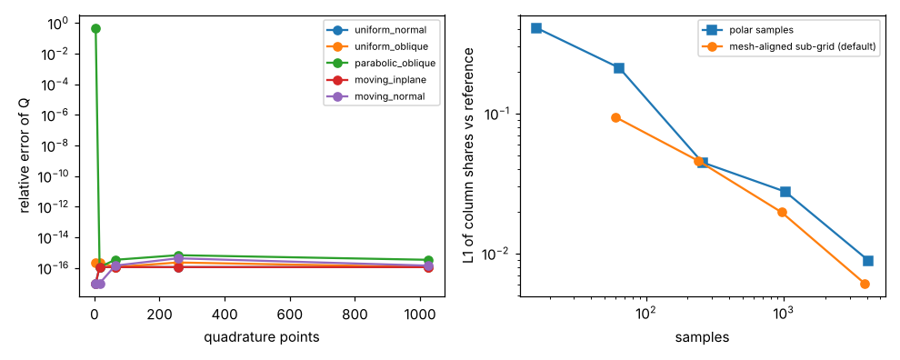
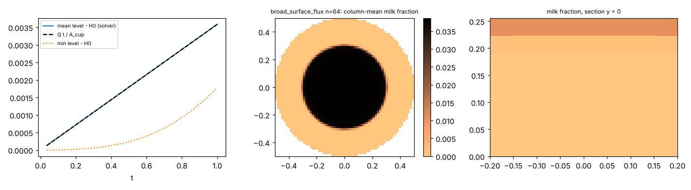
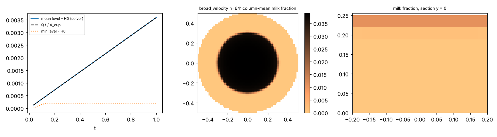
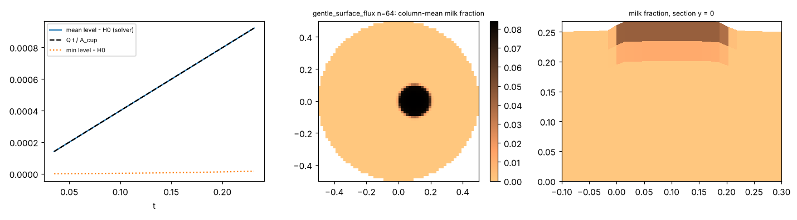
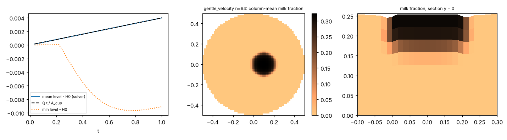
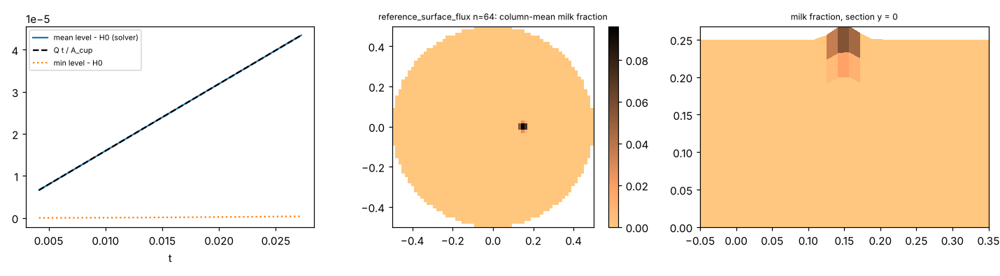
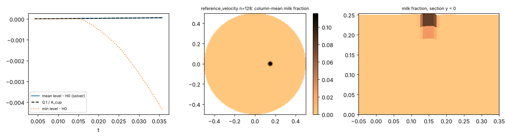

# Stage-1 verification results (auto-generated)

model_id `latte-fvm-stage1-3ed236e6b42f`, config `configs/stage1/suite.yaml`, git `6900168518cc6089a4d9af89f566e76b43a6ca66`

| test | what | status | verdict | key result | volume res. | mass res. | div. err. | steps (rej.) | wall s |
|---|---|---|---|---|---|---|---|---|---|
| T01 | V0.5 legacy volumetric-source analytic check; V0.5 baseline excluded by user decision (2026-10-28) | not_run | **not_applicable** | V0.5 legacy volumetric-source analytic check; V0.5 baseline excluded by user decision (2026-10-28) | null | null | null |  | None |
| T02 | inlet flux integral, moving section | completed | **pass** | worst finest-quadrature relative error 7.29e-15; column sum exact; column-share L1 vs reference: polar 4.10e-01 -> 8.93e-03, sub-grid 9.44e-02 -> 6.13e-03 (sub [2, 4, 8, 16]) | 8.05e-16 | null | null |  | 0.47 |
| T03 | inlet input contract | completed | **pass** | 17/17 contract checks pass | 4.31e-16 | null | null | 11 (0) | 1.4 |
| T04 | V0.5 rename-equivalence check; V0.5 baseline excluded by user decision (2026-10-28) | not_run | **not_applicable** | V0.5 rename-equivalence check; V0.5 baseline excluded by user decision (2026-10-28) | null | null | null |  | None |
| T05 | static stripes (full solver) | completed | **pass** | max|C(t)-C(0)| = 2.49e-13, max|u| = 2.07e-15 after 29 steps | 3.33e-20 | null | 5.67e-14 | 29 (0) | 4.97 |
| T06 | periodic translation | completed | **pass** | L1 decreases with n: disc [0.01035, 0.00739, 0.00494] (rates [0.49, 0.58]), bell [0.007526, 0.003843, 0.001912] (rates [0.97, 1.01]); uniform velocity across the 0.7:1 density jump kept to 0.0e+00 | null | 1.47e-14 | null |  | 460.02 |
| T07 | time-reversed vortex | completed | **pass** | return error L1 [0.05144, 0.03617, 0.02689] for n=[64, 128, 256] (rates [0.51, 0.43]); mean filament width at T/2 [0.0443, 0.045, 0.0433]; final M [0.03511, 0.02576, 0.01954] | null | 5.89e-16 | null |  | 1689.06 |
| T08 | piston displacement | completed | **pass** | front x_f vs Ut=0.5: errors ['9.6e-04', '4.6e-04', '2.2e-04', '1.1e-04']; 10-90 width [0.0438, 0.0222, 0.0113, 0.0057] (shrinks with n); downstream milk beyond x_f+0.1 <= 2.3e-07 (no whole-pipe whitening) | null | 1.89e-14 | null |  | 1.64 |
| T09 | component simplex | completed | **pass** | 200 FCT steps on random simplex data: component conservation 4.4e-16, max excursion beyond initial per-component range 0.0e+00, min fraction 6.13e-15; sum-to-one 1.1e-16 (structural: third component derived) | null | 4.44e-16 | null |  | 0.92 |
| T10 | pure vertical remap | completed | **pass** | 30 remaps (uniform->geometric->random->uniform x10): conservation 7.8e-16, bounds 0.0e+00; profile L1 (order 2) ['9.82e-02', '3.00e-02', '6.93e-03', '1.16e-03'] for N=[8, 16, 32, 64] | null | 7.77e-16 | null |  | 0.41 |
| T11 | hydrostatic balance | completed | **pass** | equal_density: max|u| 1.3e-13, level drift 1.3e-14; foam_top_layers: max|u| 1.7e-13, level drift 1.1e-14; linear_stratification: max|u| 1.6e-13, level drift 1.1e-14 | 0.00e+00 | 2.33e-16 | 1.63e-13 | 123 (0) | 6.8 |
| T12 | common pressure projection | completed | **pass** | sloped surface (max slope 0.062), random density 0.7-1, random v*, prescribed wall flux: e_div 6.8e-16, L symmetric to 2.6e-17, lambda_min 1.62e-02 > 0, idempotence 1.0e-15, gradient removal 7.5e-16; rigid lid: null space dim 1, e_div 9.2e-15 | null | null | 6.81e-16 |  | 0.09 |
| T13 | two-layer viscous exchange | completed | **pass** | relative-velocity decay matches the backward-Euler two-mass solution to 3.2e-14 (continuous exponential to 2.2e-04, O(dt)); total momentum kept to 2.3e-14; KE non-increasing: True | null | 2.34e-14 | null | 500 (0) | 1.71 |
| T14 | interlayer material exchange | completed | **pass** | one exchange step each way: loss=gain, donor composition and donor momentum carried, worst error 4.4e-16 | null | 0.00e+00 | null |  | 0.0 |
| T15 | injection and liquid level | completed | **pass** | reference_velocity n=64 (2.6 cells/diameter) t=0.092: level err 0.0e+00, volume res 4.4e-17, brown change 0.0e+00, min/max level vs mean -0.0127/+0.0040; reference_velocity n=128 (5.1 cells/diameter) t=0.036: level err 9.7e-13, volume res 1.6e-16, brown change 0.0e+00, min/max level vs mean -0.0044/+0.0041; reference_surface_flux n=64 (2.6 cells/diameter) t=0.027: level err 0.0e+00, volume res 1.1e-16, brown change 0.0e+00, min/max level vs mean -0.0000/+0.0207; gentle_velocity n=64 (12.8 cells/diameter) t=1.000: level err 1.4e-14, volume res 8.7e-18, brown change 0.0e+00, min/max level vs mean -0.0131/+0.0030; gentle_surface_flux n=64 (12.8 cells/diameter) t=0.231: level err 6.0e-14, volume res 3.8e-17, brown change 0.0e+00, min/max level vs mean -0.0009/+0.0176; broad_velocity n=64 (38.4 cells/diameter) t=1.000: level err 4.3e-13, volume res 7.2e-17, brown change 0.0e+00, min/max level vs mean -0.0034/+0.0024; broad_surface_flux n=64 (38.4 cells/diameter) t=1.000: level err 2.9e-13, volume res 7.2e-17, brown change 0.0e+00, min/max level vs mean -0.0018/+0.0023. Stopped runs: ['reference_velocity n=64: OUT_OF_SCOPE at t=0.092', 'reference_velocity n=128: OUT_OF_SCOPE at t=0.036', 'reference_surface_flux n=64: OUT_OF_SCOPE at t=0.027', 'gentle_surface_flux n=64: OUT_OF_SCOPE at t=0.231'] | 1.64e-16 | 3.76e-11 | 3.78e-13 | 256 (153) | 197.02 |
| T16 | density / buoyancy | completed | **review** | equal-density blob: max|u| 5.0e-16; buoyant blob (rho 0.7 in 1.0) rises by [0.0121, 0.0129, 0.0129] for nx=[32, 64, 128] (successive differences ['7.8e-04', '4.7e-06']); no reference solution, so magnitude is 'review' | 2.22e-16 | 5.31e-12 | 1.70e-13 | 97 (0) | 5.02 |
| T17 | surface / wall / inlet switch-off | completed | **pass** | flat surface with sigma=0.01: max|u| 4.9e-15; capillary dynamics see W02; inlet switch-off leaves no constraint (bitwise identical: True); cup-edge meniscus part BLOCKED (contact-line model undecided) | null | null | null | 65 (0) | 8.02 |
| T17b | cup-edge meniscus / contact line: contact-angle and slip model not chosen (V3 Sec. 6, to seal before real-cup tests) | blocked | **not_applicable** | cup-edge meniscus / contact line: contact-angle and slip model not chosen (V3 Sec. 6, to seal before real-cup tests) | null | null | null |  | None |
| W01 | extra: non-hydrostatic gravity-wave dispersion | completed | **pass** | period error vs omega^2 = (g k + sigma k^3/rho) tanh(kH) (sigma=0.0): ['+4.15%', '+0.98%', '+0.22%'] for (nx,N)=[[16, 4], [32, 8], [64, 16]] (observed order [2.08, 2.14]); hydrostatic theory would differ by -23.6%; amplitude kept [0.863, 0.973, 0.996] with mu=0 (numerical damping) | 0.00e+00 | null | null |  | 2.11 |
| W02 | extra: capillary-gravity wave dispersion | completed | **pass** | period error vs omega^2 = (g k + sigma k^3/rho) tanh(kH) (sigma=0.01): ['+4.59%', '+1.17%', '+0.29%'] for (nx,N)=[[16, 4], [32, 8], [64, 16]] (observed order [1.97, 2.01]); hydrostatic theory would differ by -23.6%; amplitude kept [0.867, 0.974, 0.995] with mu=0 (numerical damping) | 0.00e+00 | null | null |  | 9.19 |

## Figures

**T02** `T02_quadrature.png`  

**T15** `T15_broad_surface_flux.png`  

**T15** `T15_broad_velocity.png`  

**T15** `T15_gentle_surface_flux.png`  

**T15** `T15_gentle_velocity.png`  

**T15** `T15_reference_surface_flux.png`  

**T15** `T15_reference_velocity.png`  

